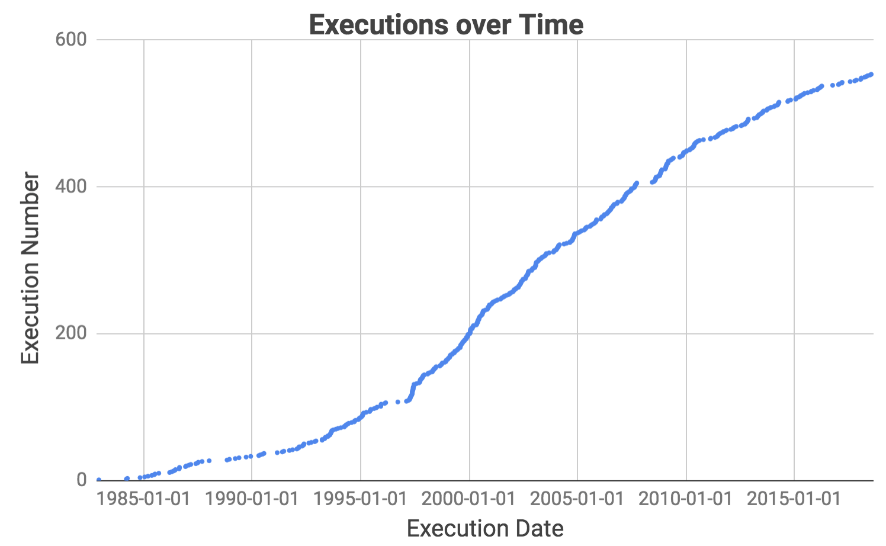
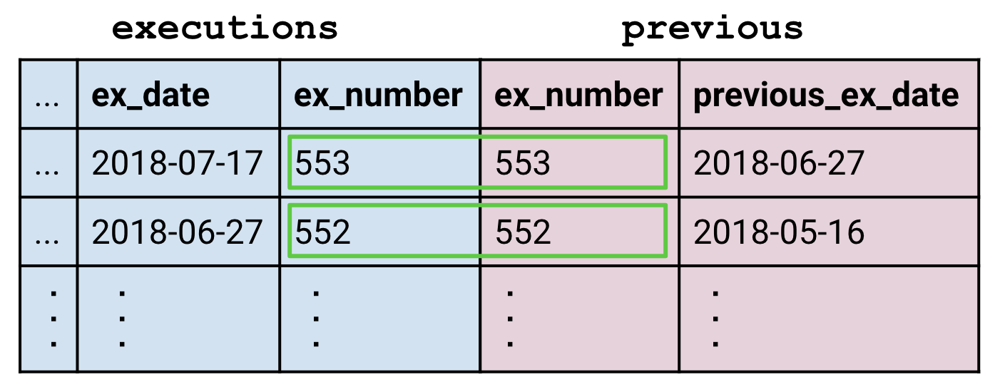
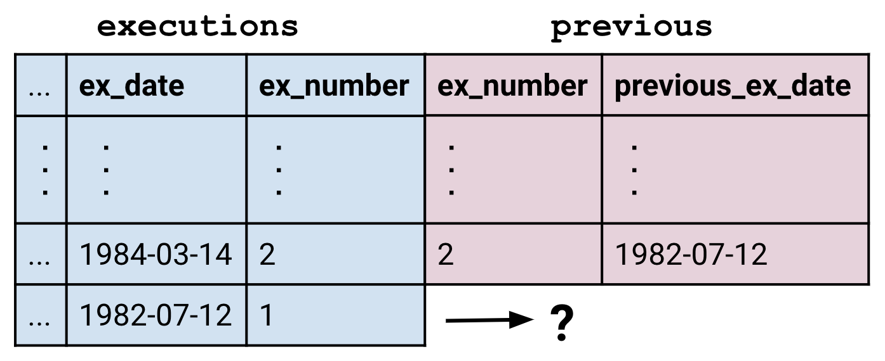
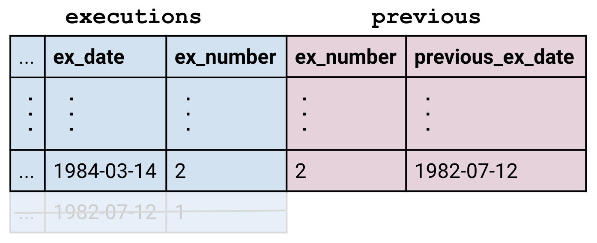
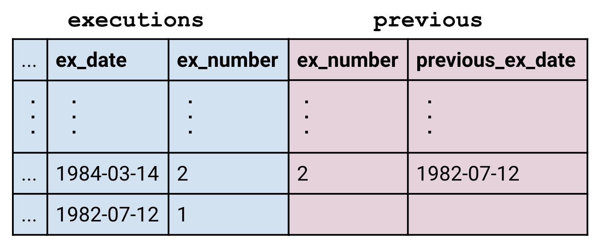
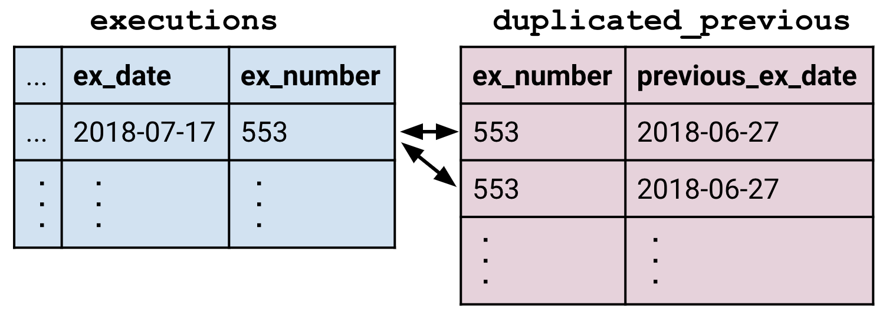
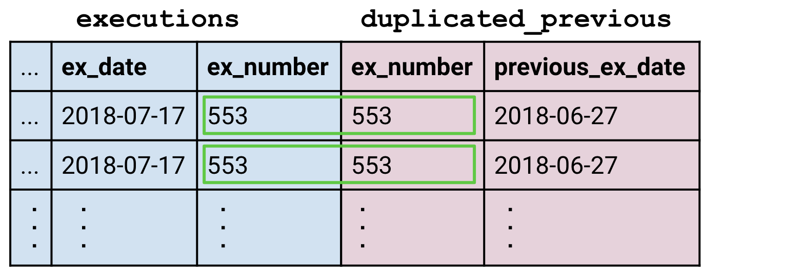
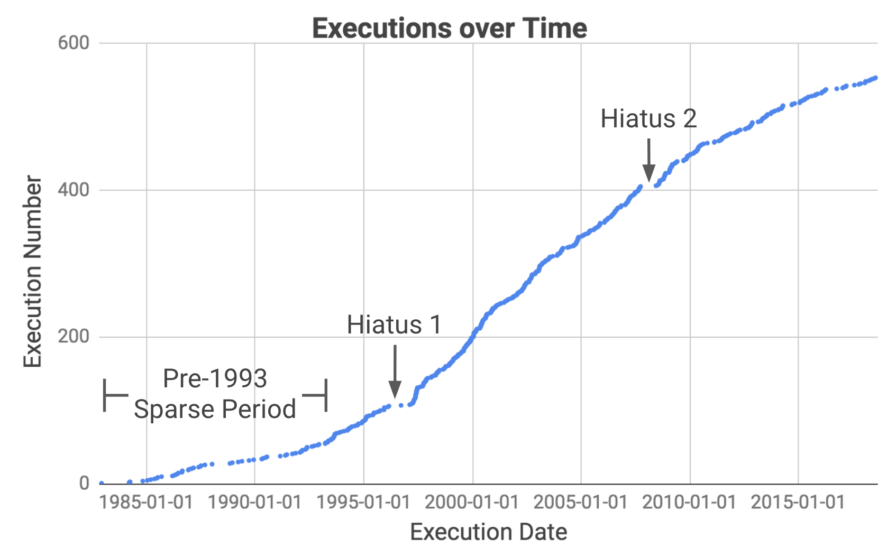

## বিরতিসমূহ
এই গ্রাফটি সময়ের সাথে সাথে মৃত্যুদণ্ড কার্যকরের সংখ্যা প্রদর্শন করছে। লক্ষ্য করুন যে বেশ কয়েকটি দীর্ঘ সময়কাল রয়েছে যখন কোনো মৃত্যুদণ্ড কার্যকর হয়নি। আমাদের লক্ষ্য হলো এই বিরতিগুলো ঠিক কখন ঘটেছিল তা বের করা এবং সেগুলোর পেছনের কারণ অনুসন্ধান করা।

আমাদের কৌশল হলো টেবিলটিকে এমন একটি অবস্থায় নিয়ে আসা যাতে প্রতিটি সারিতে তার ঠিক পূর্ববর্তী মৃত্যুদণ্ড কার্যকরের তারিখটিও অন্তর্ভুক্ত থাকে। এরপর আমরা দুটি তারিখের মধ্যে সময়ের ব্যবধান (দিন হিসেবে) বের করতে পারি, সেগুলোকে বড় থেকে ছোট (descending) ক্রমে সাজাতে পারি, এবং সবচেয়ে দীর্ঘ বিরতিগুলো সহজেই চিহ্নিত করতে পারি।

 

## জয়েন (JOIN) সম্পর্কিত ধারণা
আমরা এ পর্যন্ত যেসব কৌশল শিখেছি তার কোনোটিই এখানে পর্যাপ্ত নয়। আমাদের কাঙ্ক্ষিত টেবিলটির দৈর্ঘ্য মূল `executions` টেবিলের সমান হওয়া প্রয়োজন, তাই আমরা এগ্রিগেশনের সম্ভাবনা বাতিল করতে পারি—কারণ এগ্রিগেশন তুলনামূলক ছোট টেবিল তৈরি করে। [বিজলির শেষ জবানবন্দি](beazley.html) অধ্যায়ে আমরা কেবল সারি-ভিত্তিক অপারেশন শিখেছিলাম যা আমাদের একটি সারির মধ্যে থাকা তথ্যের মধ্যেই সীমাবদ্ধ রাখে। কিন্তু পূর্ববর্তী মৃত্যুদণ্ডের তারিখটি বর্তমান সারির বাইরে অবস্থান করে, তাই অতিরিক্ত তথ্য সংযুক্ত করার জন্য আমাদের `JOIN` ব্যবহার করতে হবে।

ধরা যাক, আমরা যে অতিরিক্ত তথ্যটি চাই তা `previous` নামের একটি টেবিলে রয়েছে, যাতে দুটি কলাম আছে: `(ex_number, last_ex_date)`। তাহলে আমাদের কাজটি সম্পন্ন করার জন্য আমরা নিচের কুয়েরিটি চালাতে সক্ষম হব:

    SELECT
      last_ex_date AS start,
      ex_date AS end,
      ex_date - last_ex_date AS day_difference
    FROM executions
    JOIN previous
      ON executions.ex_number = previous.ex_number
    ORDER BY day_difference DESC
    LIMIT 10

এই অধ্যায়ের মূল কেন্দ্রবিন্দু হলো `JOIN` ব্লক। এটিকে একক একটি লাইন হিসেবে দেখার চেয়ে এভাবে দেখা প্রায়শই বেশি সহায়ক:  এটি স্পষ্টভাবে তুলে ধরে কীভাবে `JOIN` একটি বড় যৌথ টেবিল তৈরি করে যা অন্য যেকোনো টেবিলের মতোই `FROM` ব্লকে প্রবেশ করানো হয়।

  <h3>কলাম দ্ব্যর্থতাহীন করা (Disambiguating Columns)</h3>
  
উপরের কুয়েরিটি আরেকটি কারণে বিশেষভাবে লক্ষণীয়—এখানে <code>executions.ex_number = previous.ex_number</code> ক্লজটি কলাম নির্দিষ্ট করার জন্য <code>&lt;table&gt;.&lt;column&gt;</code> বিন্যাস ব্যবহার করেছে। এটি এখানে কেবল এই কারণেই আবশ্যক হয়েছে যে উভয় টেবিলেই <code>ex_number</code> নামের একটি কলাম রয়েছে।

 

## জয়েনের প্রকারভেদ
`JOIN` ব্লকের সাধারণ গঠন হলো <code class='codeblock'>&lt;table1&gt; JOIN &lt;table2&gt; ON &lt;clause&gt;</code>। এই ক্লজটি ঠিক <code class='codeblock'>WHERE &lt;clause&gt;</code>-এর মতোই কাজ করে। অর্থাৎ, এটি এমন একটি উক্তি যা সত্য (true) বা মিথ্যা (false) হিসেবে মূল্যায়িত হয়; এবং যখনই প্রথম টেবিলের একটি সারি এবং দ্বিতীয় টেবিলের আরেকটি সারি ক্লজের শর্ত পূরণ করে সত্য হয়, তখন সেই দুটি সারি পরস্পরের সাথে মেলানো (matched) হয়:

কিন্তু যেসব সারির কোনো মিল পাওয়া যায় না তাদের ক্ষেত্রে কী ঘটে? এই পরিস্থিতিতে, ১ নম্বর মৃত্যুদণ্ডের জন্য `previous` টেবিলে কোনো সারি ছিল না, কারণ এর পূর্বে কোনো মৃত্যুদণ্ড কার্যকর হয়নি।

ডিফল্টভাবে <code>JOIN</code> কমান্ড তথাকথিত "ইনার জয়েন" (inner join) সম্পাদন করে, যাতে অমিল থাকা (unmatched) সারিগুলো বাদ দেওয়া হয়।

বামপাশের টেবিলের সমস্ত সারি অক্ষুণ্ণ রাখতে, আমরা সাধারণ <code>JOIN</code>-এর পরিবর্তে <code>LEFT JOIN</code> ব্যবহার করি। সারির খালি অংশগুলো অপরিবর্তিত থাকে, যার অর্থ হলো সেগুলোর মান <code>NULL</code> হিসেবে মূল্যায়িত হয়।

ডানপাশের টেবিলে অমিল থাকা সারিগুলো সংরক্ষণ করার জন্য <code>RIGHT JOIN</code> ব্যবহার করা যেতে পারে, এবং উভয় টেবিলেরই অমিল থাকা সারিগুলো সংরক্ষণ করতে <code>OUTER JOIN</code> ব্যবহার করা যেতে পারে।

সর্বশেষ সূক্ষ্ম বিষয়টি হলো একাধিক মিল (multiple matches) পরিচালনা করা। ধরা যাক আমাদের কাছে একটি `duplicated_previous` টেবিল রয়েছে যাতে `previous` টেবিলের প্রতিটি সারির দুটি করে প্রতিলিপি (copy) বিদ্যমান। ফলে `executions`-এর প্রতিটি সারি এখন `duplicated_previous`-এর দুটি সারির সাথে মিলে যায়।

এই জয়েনটি `executions`-এর পর্যাপ্ত সারি তৈরি করে যাতে `duplicated_previous`-এর প্রতিটি মিল থাকা সারি তার নিজস্ব সঙ্গী খুঁজে পায়। এইভাবে, জয়েন এমন যৌথ টেবিল তৈরি করতে পারে যা তাদের মূল গঠনকারী উপাদান টেবিলগুলোর চেয়েও আকারে বড়।

<sql-quiz
  data-title="যে বাক্যগুলো সত্য সেগুলোতে টিক চিহ্ন দিন।"
  data-en-title="Mark the true statements."
  data-description="ধরা যাক আমাদের কাছে ৩টি সারির tableA এবং ৫টি সারির tableB রয়েছে।"
  data-en-description="Suppose we have tableA with 3 rows and tableB with 5 rows.">
  <sql-quiz-option
    data-value="cartesian_prod"
    data-statement="<code>tableA JOIN tableB ON 1</code> ১৫টি সারি প্রদান করে।"
    data-hint="<code>ON 1</code> ক্লজটি সর্বদা সত্য, তাই tableA-এর প্রতিটি সারি tableB-এর প্রতিটি সারির সাথে মেলানো (matched) হয়।"
    data-correct="true"></sql-quiz-option>
  <sql-quiz-option
    data-value="bad_cartesian"
    data-statement="<code>tableA JOIN tableB ON 0</code> ০টি সারি প্রদান করে।"
    data-hint="ঠিক যে কারণে <code>ON 1</code> ১৫টি সারি প্রদান করে, সেই একই যুক্তিতে।"
    data-correct="true"></sql-quiz-option>
  <sql-quiz-option
    data-value="left_join_bad"
    data-statement="<code>tableA LEFT JOIN tableB ON 0</code> ৩টি সারি প্রদান করে।"
    data-hint="লেফট জয়েন tableA-এর সমস্ত সারি সংরক্ষণ করে, যদিও tableB-এর কোনো সারি মেলে না।"
    data-correct="true"></sql-quiz-option>
  <sql-quiz-option
    data-value="outer_join_bad"
    data-statement="<code>tableA OUTER JOIN tableB ON 0</code> ৮টি সারি প্রদান করে।"
    data-hint="আউটার জয়েন tableA এবং tableB উভয়ের সমস্ত সারি সংরক্ষণ করে, যদিও তাদের কোনো জোড়া গঠিত হয়নি।"
    data-correct="true"></sql-quiz-option>
  <sql-quiz-option
    data-value="outer_join_good"
    data-statement="<code>tableA OUTER JOIN tableB ON 1</code> ১৫টি সারি প্রদান করে।"
    data-hint="<code>ON 1</code> ক্লজের কারণে tableA-এর সমস্ত সারি tableB-এর সমস্ত সারির সাথে মেলে যায়, তাই যেকোনো জয়েন ১৫টি সারিই প্রদান করবে। বিভিন্ন জয়েনের মধ্যে পার্থক্য কেবল অমিল (unmatched) সারিগুলো মোকাবিলার পদ্ধতিতে।"
    data-correct="true"></sql-quiz-option>
</sql-quiz>

 

## তারিখ (Dates)
আসুন জয়েন থেকে সাময়িক বিরতি নিয়ে আমাদের টেমপ্লেট কুয়েরির এই লাইনটির দিকে লক্ষ্য করি:

      ex_date - last_ex_date AS day_difference

আমরা একটি বড় ধরনের অনুমান করে নিয়েছি যে আমরা একটি তারিখ থেকে আরেকটি তারিখ সরাসরি বিয়োগ করতে পারি। কিন্তু কল্পনা করুন আপনি হলেন কম্পিউটার এবং আপনার কাছে এমন একটি লাইন এসেছে। আপনি কি তারিখ দুটির মধ্যকার দিনের ব্যবধান ফেরত দেবেন? ঘণ্টা বা সেকেন্ড কেন নয়? পরিস্থিতিকে আরও জটিল করে তোলে এটি যে SQLite-এ (অন্যান্য বেশিরভাগ SQL ডায়ালেক্টের বিপরীতে) প্রকৃতপক্ষে কোনো নির্দিষ্ট তারিখ বা সময়ের টাইপ (date or time types) নেই; ফলে আপনার কাছে `ex_date` এবং `last_ex_date` কলামগুলোকে সাধারণ স্ট্রিং বা টেক্সট মনে হয়। আপনাকে মূলত `'hello' - 'world'` বিয়োগ করতে বলা হচ্ছে। এর আসলে কী অর্থ হতে পারে?

সৌভাগ্যবশত, কম্পিউটারকে বোঝানোর জন্য SQLite-এ বেশ কিছু ফাংশন রয়েছে: "শোনো, আমি তোমাকে যে স্ট্রিংগুলো পাঠাচ্ছি সেগুলোতে আসলে তারিখ বা সময় রয়েছে। তুমি এদের ওপর তারিখের মতোই আচরণ করো।"

<sql-exercise
 data-question='তারিখ দুটির মধ্যবর্তী দিনের সংখ্যা ফেরত পেতে কুয়েরিটি ঠিক করতে <a href="https://www.sqlite.org/lang_datefunc.html">ডকুমেন্টেশন</a> দেখে নিন।'
 data-en-question='Look up <a href="https://www.sqlite.org/lang_datefunc.html">the documentation</a> to fix the query so that it returns the number of days between the dates.'
 data-default-text="SELECT '1993-08-10' - '1989-07-07' AS day_difference"
 data-solution="
SELECT JULIANDAY('1993-08-10') - JULIANDAY('1989-07-07') AS day_difference"
></sql-exercise>

 

## সেলফ জয়েন (Self Joins)
তারিখ সম্পর্কে আমরা যা শিখলাম, তা দিয়ে আমরা আমাদের টেমপ্লেট কুয়েরিটি সংশোধন করতে পারি:

    SELECT
      last_ex_date AS start,
      ex_date AS end,
      JULIANDAY(ex_date) - JULIANDAY(last_ex_date)
        AS day_difference
    FROM executions
    JOIN previous
      ON executions.ex_number = previous.ex_number
    ORDER BY day_difference DESC
    LIMIT 5

পরবর্তী ধাপ হলো `previous` টেবিলটি তৈরি করা।
<sql-exercise
  data-question="<code>previous</code> টেবিলটি তৈরি করার জন্য একটি কুয়েরি লিখুন।"
  data-en-question="Write a query to produce the <code>previous</code> table."
  data-comment="কলামগুলোর নাম <code>(ex_number, last_ex_date)</code> তৈরি করতে অ্যালাইয়াস (alias) ব্যবহার করতে ভুলবেন না। ইঙ্গিত: তারিখগুলোকে পেছনে নেওয়ার বদলে আপনি <code>ex_number</code>-কে এক ধাপ এগিয়ে নিতে পারেন!"
  data-solution="
SELECT
  ex_number + 1 AS ex_number,
  ex_date AS last_ex_date
FROM executions
WHERE ex_number < 553"></sql-exercise>

এখন আমরা এই কুয়েরিটিকে আমাদের উপরের টেমপ্লেটে নেস্ট করতে পারি:
<sql-exercise
  data-question="টেমপ্লেটের ভেতরে <code>previous</code> টেবিল তৈরি করা কুয়েরিটি নেস্ট করুন।"
  data-en-question="Nest the query which generates the <code>previous</code> table into the template."
  data-comment='লক্ষ্য করুন যে আমরা এখানে একটি টেবিল অ্যালাইয়াস (table alias) ব্যবহার করছি, যেখানে নেস্টেড কুয়েরির ফলাফলটির নাম দেওয়া হয়েছে "previous"।'
  data-default-text="SELECT
  last_ex_date AS start,
  ex_date AS end,
  JULIANDAY(ex_date) - JULIANDAY(last_ex_date)
    AS day_difference
FROM executions
JOIN (<your-query>) previous
  ON executions.ex_number = previous.ex_number
ORDER BY day_difference DESC
LIMIT 10"
  data-solution="
SELECT
  last_ex_date AS start,
  ex_date AS end,
  JULIANDAY(ex_date) - JULIANDAY(last_ex_date) AS day_difference
FROM executions
JOIN (
    SELECT
      ex_number + 1 AS ex_number,
      ex_date AS last_ex_date
    FROM executions
  ) previous
  ON executions.ex_number = previous.ex_number
ORDER BY day_difference DESC
LIMIT 10"
></sql-exercise>

`previous` টেবিলটি `executions` থেকেই প্রস্তুত করা হয়েছে, কাজেই আমরা কার্যত `executions`-কে তার নিজের সাথেই জয়েন করছি। একে বলা হয় "সেলফ জয়েন" (self join) এবং একই টেবিলের অন্যান্য অংশ থেকে কোনো সারিতে তথ্য নিয়ে আসার জন্য এটি একটি অত্যন্ত শক্তিশালী কৌশল।

আমরা `previous` টেবিলটি তৈরি করেছিলাম মূলত এটি যে উদ্দেশ্য পূরণ করে তা স্পষ্ট করার জন্য। কিন্তু আমরা আসলে `executions` টেবিলটিকে সরাসরি তার নিজের সাথেই জয়েন করে কুয়েরিটিকে আরও মার্জিতভাবে লিখতে পারি।
<sql-exercise
  data-question="পূর্ববর্তী কুয়েরিটির একটি আরও মার্জিত সংস্করণ সম্পন্ন করতে <code>JOIN ON</code> ক্লজটি পূরণ করুন।"
  data-en-question="Fill in the <code>JOIN ON</code> clause to complete a more elegant version of the previous query."
  data-comment="মনে রাখবেন, আমরা যেন দ্ব্যর্থতাহীনভাবে যেকোনো একটি কপিকে নির্দিষ্ট করতে পারি, সেজন্য একটি কপিকে অবশ্যই একটি অ্যালাইয়াস দিতে হবে।"
  data-default-text="SELECT
  previous.ex_date AS start,
  executions.ex_date AS end,
  JULIANDAY(executions.ex_date) - JULIANDAY(previous.ex_date)
    AS day_difference
FROM executions
JOIN executions previous
  ON <your-clause>
ORDER BY day_difference DESC
LIMIT 10"
  data-solution="
SELECT
  previous.ex_date AS start,
  executions.ex_date AS end,
  JULIANDAY(executions.ex_date) - JULIANDAY(previous.ex_date)
    AS day_difference
FROM executions
JOIN executions previous
  ON executions.ex_number = previous.ex_number + 1
ORDER BY day_difference DESC
LIMIT 10"
></sql-exercise>

এখন বিরতিগুলোর সুনির্দিষ্ট তারিখ ব্যবহার করে আমরা প্রতিটি সময়কালে আসলে কী ঘটেছিল তা অনুসন্ধান করতে পারি। মৃত্যুদণ্ডের ওপর থেকে নিষেধাজ্ঞা প্রত্যাহারের পরপরই শুরুর বছরগুলোতে মৃত্যুদণ্ড কার্যকরের সংখ্যার মধ্যে দীর্ঘ বিরতি দেখা গিয়েছিল, যার কারণ ছিল মৃত্যুদণ্ডের রায়ের স্বল্প সংখ্যা এবং সেই সাথে নতুন আইনের বিরুদ্ধে আইনি চ্যালেঞ্জ। তাই আমরা ১৯৯৩ সালের পূর্ববর্তী বিরতিগুলোকে বাদ দিয়ে এর পরবর্তী দুটি প্রধান বিরতির ওপর দৃষ্টি নিবদ্ধ করি।

১ম বিরতিটির কারণ ছিল <a href="https://en.wikipedia.org/wiki/Antiterrorism_and_Effective_Death_Penalty_Act_of_1996">Antiterrorism and Effective Death Penalty Act of 1996</a>-এর বিরুদ্ধে আইনি চ্যালেঞ্জ, যা ১৯৯৩ সালের ওয়ার্ল্ড ট্রেড সেন্টার এবং ১৯৯৫ সালের ওকলাহোমা সিটি বোমা হামলার প্রতিক্রিয়ায় প্রণয়ন করা হয়েছিল। আইনটি বিশেষ করে সন্ত্রাসবাদের মামলায় মৃত্যুদণ্ডকে আরও কার্যকর করার উদ্দেশ্যে আপিল প্রক্রিয়াকে সীমিত করেছিল (<a href="https://deathpenaltyinfo.org/documents/1996YearEndRpt.pdf">উৎস</a>)।

২য় বিরতিটি ঘটেছিল সুপ্রিম কোর্টের জারি করা স্থগিতাদেশের (stay) কারণে, যখন আদালত <a href="https://en.wikipedia.org/wiki/Baze_v._Rees">Baze v. Rees</a> মামলার বিষয়ে বিবেচনা করছিল—যেখানে পরীক্ষা করা হয়েছিল যে প্রাণঘাতী ইনজেকশন (lethal injection) দেওয়া "নিষ্ঠুর এবং অস্বাভাবিক শাস্তি" (cruel and unusual punishment) নিষিদ্ধকারী মার্কিন সংবিধানের অষ্টম সংশোধনী (Eighth Amendment) লঙ্ঘন করে কি না। এটি সমগ্র আমেরিকা জুড়েই মৃত্যুদণ্ড কার্যকরের ক্ষেত্রে প্রভাব ফেলেছিল, কারণ বেশিরভাগ অঙ্গরাজ্যই কেনটাকির মতো একই ধরনের ওষুধের মিশ্রণ ব্যবহার করছিল। সুপ্রিম কোর্ট অবশেষে কেনটাকি আদালতের সিদ্ধান্ত বহাল রাখে এবং কয়েক মাস পরে টেক্সাসে আবারও মৃত্যুদণ্ড কার্যকর করা শুরু হয়।

 

## সারসংক্ষেপ

`JOIN`-এর মূল ভাবনাটি ছিল একটি বর্ধিত যৌথ টেবিল তৈরি করা, কারণ মূল টেবিলে আমাদের প্রয়োজনীয় সমস্ত তথ্য ছিল না। এটি একটি অত্যন্ত শক্তিশালী ধারণা, কারণ এটি আমাদের একক টেবিলের সীমাবদ্ধতা থেকে মুক্তি দেয় এবং একাধিক টেবিলকে বিভিন্ন জটিল উপায়ে একত্রিত করার সুযোগ করে দেয়। আমরা এও দেখেছি যে এই অতিরিক্ত জটিলতার সাথে সাথে সূক্ষ্ম হিসাব-নিকাশ বজায় রাখাও অত্যন্ত গুরুত্বপূর্ণ হয়ে ওঠে। টেবিলের অ্যালাইয়াস নির্ধারণ করা, কলামের নতুন নাম দেওয়া এবং সঠিক `JOIN ON` ক্লজ সংজ্ঞায়িত করা—এই সবই এমন কৌশল যা শৃঙ্খলা বজায় রাখতে সাহায্য করে।
