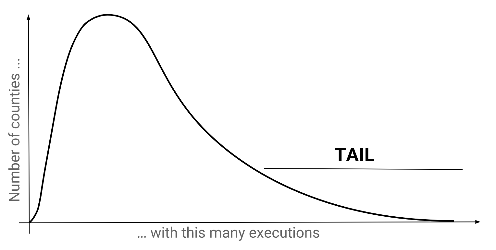

## লং টেইল
লং টেইল (Long tail বা লম্বা লেজ) বলতে উপাত্তের এমন বিন্যাসকে বোঝায় যেখানে অল্প কিছু সংখ্যক নমুনা অস্বাভাবিক রকম বেশি বার সংঘটিত হয়। এগুলোকে যখন লেখচিত্রে (plot) উপস্থাপন করা হয়, তখন মূল ঘনত্বের অনেক ডানে একটি সরু লম্বা ফালির মতো অংশ তৈরি হয়, যা দেখতে লেজের মতো দেখায়। এটি এমন কিছু আউটলায়ার (outlier বা ব্যতিক্রমী মান) নির্দেশ করে যাদের অস্বাভাবিক আচরণ আমাদের কাছে বিশেষভাবে আকর্ষণীয় বা আগ্রহোদ্দীপক হতে পারে। টেক্সাসের মৃত্যুদণ্ডের প্রেক্ষাপটে, লং টেইল বলতে সেই অল্প কয়েকটি কাউন্টিকে (county) বোঝায় যেগুলোতে অস্বাভাবিক বেশি সংখ্যক মৃত্যুদণ্ড কার্যকর করার নজির রয়েছে।

চলুন প্রতিটি কাউন্টি থেকে কার্যকর হওয়া মৃত্যুদণ্ডের শতকরা হার নির্ণয় করি, যাতে লেজের অংশে অবস্থিত কাউন্টিগুলোকে আমরা আলাদা করতে পারি।

আমরা সামনে যত এগোব ততই স্পষ্ট হবে যে—টেবিলের গঠন বা রূপ দেখেই বুঝতে পারা যায় আমাদের কোন ধরনের অপারেশন পরিচালনা করতে হবে। (এটি পদার্থবিজ্ঞানের মাত্রিক বিশ্লেষণের মতো অনেকটা।) এই ক্ষেত্রে আমরা সহজেই বুঝতে পারছি যে এ পর্যন্ত আমরা যেসব পদ্ধতি শিখেছি তা যথেষ্ট নয়: [বিজলির শেষ জবানবন্দি](beazley.html) অধ্যায়ে আমরা একক সারি নিয়ে কাজ করেছি, কিন্তু কাউন্টি-পর্যায়ের উপাত্ত পাওয়ার জন্য আমাদের যে এগ্রিগেশন করতে হবে তা স্পষ্ট। আবার [নির্দোষিতার দাবি](innocence.html) অধ্যায়ে আমরা এগ্রিগেশন শিখেছি বটে, তবে সেই ফাংশনগুলো সম্পূর্ণ ডেটাসেটকে সংকুচিত করে একটিমাত্র সারিতে নামিয়ে আনে; অথচ আমাদের প্রয়োজন প্রতিটি কাউন্টির জন্য একটি করে পৃথক সারি।

 

## GROUP BY ব্লক
ঠিক এখানেই `GROUP BY` ব্লকের আগমন। এটি আমাদের পুরো ডেটাসেটকে বিভিন্ন গ্রুপে বিভক্ত করার এবং প্রতিটি গ্রুপের মধ্যে আলাদাভাবে এগ্রিগেশন ফাংশন প্রয়োগ করার সুযোগ দেয়; যার ফলে প্রতি গ্রুপের জন্য একটি করে সারি তৈরি হয়। এর সবচেয়ে মৌলিক গঠন হলো <code class="codeblock">GROUP BY &lt;column&gt;, &lt;column&gt;, ...</code> এবং এটি সর্বদা `WHERE` ব্লকের পরে বসে।

<sql-exercise
  data-question="এই কুয়েরিটি প্রতি কাউন্টিতে মৃত্যুদণ্ড কার্যকরের সংখ্যা নিয়ে আসে।"
  data-default-text="SELECT
  county,
  COUNT(*) AS county_executions
FROM executions
GROUP BY county"></sql-exercise>

আপনার যদি <a href='innocence.html#strange'>একটি অদ্ভুত কুয়েরি</a>-র কথা মনে থাকে, তবে আপনার মাথায় হয়তো সতর্কবার্তা বেজে উঠবে। আমরা কি এইমাত্র শিখিনি যে এগ্রিগেটেড এবং নন-এগ্রিগেটেড কলাম কখনো একসাথে মেলানো যায় না? এখানকার মূল পার্থক্য হলো—গ্রুপিং কলামগুলোই হলো একমাত্র কলাম যাদের ক্ষেত্রে নন-এগ্রিগেটেড থাকার অনুমতি রয়েছে। কারণ ওই গ্রুপের অন্তর্ভুক্ত সমস্ত সারিতেই সংশ্লিষ্ট কলামের মান অবশ্যই অভিন্ন থাকে, ফলে ফলাফলে কোন মানটি প্রদর্শিত হবে তা নিয়ে কোনো অস্পষ্টতা বা দ্বন্দ্ব থাকে না।

আপনি হয়তো লক্ষ্য করেছেন যে আমরা এখানে `AS` ব্যবহার করেছি। একে "অ্যালিয়াসিং" (aliasing বা ছদ্মনাম প্রদান) বলা হয়। `SELECT` ব্লকে <code class="codeblock">&lt;expression&gt; AS &lt;alias&gt;</code> এমন একটি বিকল্প সংক্ষিপ্ত নাম তৈরি করে যা পরবর্তীতে কুয়েরিতে ব্যবহার করা যায়। এটি দীর্ঘ অভিব্যক্তি বারবার লেখার ঝামেলা থেকে বাঁচায় এবং সেই সাথে অভিব্যক্তির উদ্দেশ্য স্পষ্টভাবে ফুটিয়ে তুলতে সাহায্য করে।

<sql-exercise
  data-question="এই কুয়েরিটি শেষ জবানবন্দিসহ এবং শেষ জবানবন্দি ছাড়া মৃত্যুদণ্ডের সংখ্যা গণনা করে। কাউন্টি অনুসারে এটিকে আরও বিস্তারিতভাবে বিভাজন করতে কুয়েরিটি সংশোধন করুন।"
  data-comment="<code>last_statement IS NOT NULL</code> ক্লজটি একটি নির্দেশক চলক (indicator variable) হিসেবে কাজ করে, যেখানে ১ মানে সত্য এবং ০ মানে মিথ্যা।"
  data-default-text="SELECT
  last_statement IS NOT NULL AS has_last_statement,
  COUNT(*)
FROM executions
GROUP BY has_last_statement"
  data-solution="SELECT
  last_statement IS NOT NULL AS has_last_statement,
  county,
  COUNT(*)
FROM executions
GROUP BY has_last_statement, county"
  ></sql-exercise>

 

## HAVING ব্লক
পরবর্তী অনুশীলনটি দেখায় যে `WHERE` ব্লকের মাধ্যমে ফিল্টার করার কাজটি গ্রুপিং এবং এগ্রিগেশন সম্পন্ন হওয়ার আগেই ঘটে থাকে। এসকিউএল সিনট্যাক্সের ক্রমেই এর প্রতিফলন দেখা যায়, কারণ `WHERE` ব্লক সর্বদা `GROUP BY` ব্লকের পূর্বে বসে।

<sql-exercise
  data-question="প্রতিটি কাউন্টিতে কার্যকর হওয়া ৫০ বছর বা তার বেশি বয়সী বন্দিদের সংখ্যা গণনা করুন।"
  data-comment="আপনি <code>CASE WHEN</code> ব্যবহার করেও এটি করতে পারেন, তবে এখানে <code>WHERE</code> ব্লক ব্যবহার করার চেষ্টা করুন।"
  data-default-text=""
  data-solution="SELECT county, COUNT(*)
FROM executions
WHERE ex_age >= 50
GROUP BY county"
  ></sql-exercise>

এ পর্যন্ত সব ঠিক আছে, কিন্তু আমরা যদি গ্রুপিং এবং এগ্রিগেশনের ফলাফলের ওপর ফিল্টার করতে চাই তবে কী হবে? সময়ের আগে ভবিষ্যতে গিয়ে তো আর তথ্য টেনে আনা সম্ভব নয়। এই সমস্যার সমাধানের জন্যই আমাদের ব্যবহার করতে হয় `HAVING`।

<sql-exercise
  data-question="যেসব কাউন্টিতে ৫০ বছর বা তার বেশি বয়সী ২ জনের বেশি বন্দির মৃত্যুদণ্ড কার্যকর করা হয়েছে সেগুলোর তালিকা তৈরি করুন।"
  data-comment="এটি পূর্ববর্তী অনুশীলনের ওপর ভিত্তি করে তৈরি। আমাদের একটি অতিরিক্ত ফিল্টার প্রয়োজন—যা এগ্রিগেশনের ফলাফলকে ব্যবহার করে। এর অর্থ হলো এটি <code>WHERE</code> ব্লকে থাকতে পারে না, কারণ সেই ফিল্টারগুলো এগ্রিগেশনের আগেই পরিচালিত হয়। <a href='https://www.w3schools.com/sql/sql_having.asp'><code>HAVING</code> ব্লক</a> সংক্রান্ত ডকুমেন্টেশন দেখুন। আপনি এটিকে এগ্রিগেশন-পরবর্তী <code>WHERE</code> ব্লক হিসেবে ভাবতে পারেন।"
  data-default-text=""
  data-solution="
SELECT county
FROM executions
WHERE ex_age >= 50
GROUP BY county
HAVING COUNT(*) > 2"
  ></sql-exercise>

 
## অনুশীলন
এই কুইজটি আপনার বোঝাপড়াকে যাচাই করার জন্য তৈরি করা হয়েছে। সবগুলো উত্তর সঠিক হলেও এর পেছনের কারণ বুঝতে ব্যাখ্যাগুলো ভালো করে পড়ুন।

<sql-quiz
  data-title="যে বাক্যগুলো সত্য সেগুলোতে টিক চিহ্ন দিন।"
  data-description="নিচের কুয়েরিটি প্রতিটি কাউন্টি এবং ১০ বছর বয়সী বয়সভিত্তিক পরিসরের (age range) বন্দিদের সংখ্যা বের করে। <pre>
SELECT
  county,
  ex_age/10 AS decade_age,
  COUNT(*)
FROM executions
GROUP BY county, decade_age</pre>">
  <sql-quiz-option
    data-value="valid"
    data-statement="কুয়েরিটি সম্পূর্ণ বৈধ (অর্থাৎ চালানোর সময় কোনো ত্রুটি বা error দেবে না)।"
    data-hint="আপনি কি <code>ex_age/10</code> দেখে বিভ্রান্ত হয়েছেন? রূপান্তরিত কলামের মাধ্যমে গ্রুপিং করাও সম্পূর্ণ বৈধ।"
    data-correct="true"></sql-quiz-option>
  <sql-quiz-option
    data-value="gran"
    data-statement="আমরা যদি <code>ex_age/10</code>-এর বদলে <code>ex_age</code> ব্যবহার করতাম, তবে কুয়েরিটি আরও বেশি সারি ফলাফল দিত।"
    data-hint="মনে রাখবেন, <code>ex_age/10</code> পূর্ণসংখ্যার ভাগ করে যা সমস্ত বয়সকে রাউন্ড করে দেয়। এর ফলে তুলনামূলক কম অনন্য (unique) গ্রুপ তৈরি হয়।"
    data-correct="true"></sql-quiz-option>
  <sql-quiz-option
    data-value="unique_combocc"
    data-statement="আউটপুটে ঠিক ততগুলো সারিই থাকবে, ডেটাসেটে কাউন্টি এবং decade_ages-এর যতগুলো অনন্য সমন্বয় (unique combination) রয়েছে।"
    data-hint="এটি সঠিক।"
    data-correct="true"></sql-quiz-option>
  <sql-quiz-option
    data-statement="আউটপুটে ('Bexar', 6) এমন একটি গ্রুপ থাকবে, যদিও মৃত্যুদণ্ড কার্যকরের সময় বেক্সার কাউন্টির কোনো বন্দির বয়স ৬০ থেকে ৬৯-এর মধ্যে ছিল না।"
    data-hint="<code>GROUP BY</code> ব্লক তাত্ত্বিকভাবে সম্ভব এমন সমস্ত সমন্বয়ের বদলে কেবল <i>উপাত্তে বিদ্যমান</i> সমন্বয়গুলোই খুঁজে বের করে।"
    data-value="abstract_cartesian"></sql-quiz-option>
  <sql-quiz-option
    data-statement="আউটপুটের প্রতিটি সারির জন্য county-র একটি ভিন্ন মান থাকবে।"
    data-hint="এটি কেবল তখনই সত্য হতো যদি কেবল <code>county</code> দিয়েই গ্রুপিং করা হতো। কিন্তু এখানে একই কাউন্টির একাধিক গ্রুপ থাকতে পারে যাদের decade_ages ভিন্ন।"
    data-value="one_col_diff"></sql-quiz-option>
  <sql-quiz-option
    data-statement="আউটপুটে এমন গ্রুপও থাকতে পারে যাদের কাউন্ট বা গণনার মান ০।"
    data-hint="এটি ('Bexar', 6) প্রশ্নের মতোই। যদি ('Bexar', 6)-এর কোনো সারি না থাকে, তবে সেই গ্রুপটি তালিকায় আসতেই পারবে না।"
    data-value="count_zero"></sql-quiz-option>
  <sql-quiz-option
    data-statement="<code>SELECT</code> ব্লকে <code>county</code> উল্লেখ না করলেও কুয়েরিটি সম্পূর্ণ বৈধ হতো।"
    data-hint="গ্রুপিং কলামগুলোকে <code>SELECT</code> ব্লকে থাকতেই হবে এমন কোনো বাধ্যবাধকতা নেই। কুয়েরিটি বৈধ হতো ঠিকই, তবে বিশেষ অর্থবহ হতো না কারণ আমরা জানতেই পারতাম না কোন গণনাটি কোন কাউন্টির জন্য।"
    data-value="missing_gp_col"
    data-correct="true"></sql-quiz-option>
  <sql-quiz-option
    data-statement="<code>last_name</code> দিয়ে গ্রুপ না করেও সেটিকে <code>SELECT</code> ব্লকে যুক্ত করা যুক্তিযুক্ত।"
    data-hint="যদিও <a href='innocence.html#strange'>একটি অদ্ভুত কুয়েরি</a>-তে আলোচিত কারণে এটি (SQLite-এ) কার্যকর হতো, তবুও <code>SELECT</code> ব্লকে নন-এগ্রিগেট ও নন-গ্রুপিং কলাম রাখা অত্যন্ত নিম্নমানের কোডিং অভ্যাস।"
    data-value="extra_gp_col"></sql-quiz-option>
</sql-quiz>

<sql-exercise
  data-question="ডেটাসেটের সমস্ত স্বতন্ত্র (distinct) কাউন্টির তালিকা তৈরি করুন।"
  data-comment="পূর্ববর্তী অধ্যায়ে আমরা <code>SELECT DISTINCT</code> কমান্ড ব্যবহার করে এটি করেছিলাম। এবার সাধারণ <code>SELECT</code> ব্যবহার করুন এবং <code>GROUP BY</code> প্রয়োগ করুন।"
  data-default-text=""
  data-solution="SELECT county FROM executions GROUP BY county"
  ></sql-exercise>

 

## নেস্টেড কুয়েরি
এখন আপনি প্রশ্ন করতে পারেন, আমরা যদি নিচের মতো কিছু একটা চালিয়ে দিতাম তবেই কি কাজ শেষ হয়ে যেত না?

    SELECT
      county,
      PERCENT_COUNT(*)
    FROM executions
    GROUP BY county

শতকরা হার তো খুবই সাধারণ একটি পরিমাপ&mdash;এমন একটি ফাংশন কি থাকা উচিত ছিল না? দুর্ভাগ্যবশত এমন কোনো ফাংশন নেই, এবং হয়তো তার সংগত কারণও রয়েছে: এমন কোনো ফাংশন তৈরি করতে হলে তাকে একই সাথে গ্রুপের ভেতরের উপাদানগুলোর এগ্রিগেশন করতে হতো (লব পাওয়ার জন্য) এবং পুরো ডেটাসেট জুড়ে এগ্রিগেশন করতে হতো (হর পাওয়ার জন্য)। কিন্তু প্রতিটি একক কুয়েরিতে হয় একটি `GROUP BY` ব্লক থাকে, নয়তো থাকে না। কাজেই আমাদের প্রকৃতপক্ষে দুটি পৃথক কুয়েরি প্রয়োজন—একটি যা `GROUP BY` সহ এগ্রিগেশন করে, এবং অন্যটি যা কোনো গ্রুপিং ছাড়াই পুরো টেবিলের ওপর এগ্রিগেশন করে। এরপর আমরা "নেস্টিং" (nesting বা একটির ভেতর আরেকটি সাজানো) নামের কৌশল ব্যবহার করে এই দুটিকে একত্রিত করতে পারি।

নেস্টিং কীভাবে কাজ করে তার একটি উদাহরণ নিচে দেওয়া হলো। ভেতরের কুয়েরি (inner query) এবং বাইরের কুয়েরির (outer query) মধ্যকার সীমারেখা সুনির্দিষ্ট করতে প্রথম বন্ধনীটি (parentheses) অত্যন্ত গুরুত্বপূর্ণ:

<sql-exercise
  data-question="সবচেয়ে দীর্ঘ শেষ জবানবন্দি দেওয়া (অক্ষরের সংখ্যার ভিত্তিতে) বন্দির প্রথম এবং শেষ নাম খুঁজে বের করুন।"
  data-comment="&lt;<code>length-of-longest-last-statement</code>&gt; এর স্থানে নেস্ট করার জন্য একটি উপযুক্ত কুয়েরি লিখুন।"
  data-default-text="SELECT first_name, last_name
FROM executions
WHERE LENGTH(last_statement) =
    (<length-of-longest-last-statement>)"
  data-solution="SELECT first_name, last_name
FROM executions
WHERE LENGTH(last_statement) =
    (SELECT MAX(LENGTH(last_statement))
     FROM executions)"></sql-exercise>

পুনরায় মনে করিয়ে দিই, এখানে নেস্টিং জরুরি কারণ `WHERE` ক্লজে কম্পিউটার যখন কোনো সারি পরীক্ষা করে দেখে যে তার শেষ জবানবন্দিটি সঠিক দৈর্ঘ্যের কি না, তখন সে বাইরের সামগ্রিক ডেটাসেটের দিকে তাকিয়ে সর্বোচ্চ দৈর্ঘ্য কত তা নিজে থেকে জানতে পারে না। আমাদের আলাদাভাবে সর্বোচ্চ দৈর্ঘ্যটি খুঁজে বের করে সেই মানটি ক্লজের ভেতরে সরবরাহ করতে হয়। এবার চলুন এই একই ধারণা প্রয়োগ করে প্রতিটি কাউন্টি থেকে কার্যকর হওয়া মৃত্যুদণ্ডের শতকরা হার নির্ণয় করা যাক।

<sql-exercise
  data-question="প্রতিটি কাউন্টি থেকে মৃত্যুদণ্ডের শতকরা হার বের করতে &lt;<code>count-of-all-rows</code>&gt; কুয়েরিটি স্থাপন করুন।"
  data-comment="<code>100.0</code> একটি দশমিক সংখ্যা যাতে আমরা দশমিক শতকরা হার পেতে পারি।"
  data-default-text="SELECT
  county,
  100.0 * COUNT(*) / (<count-of-all-rows>)
    AS percentage
FROM executions
GROUP BY county
ORDER BY percentage DESC"
  data-solution="SELECT
  county,
  100.0 * COUNT(*) / (SELECT COUNT(*) FROM executions)
    AS percentage
FROM executions
GROUP BY county
ORDER BY percentage DESC"
  ></sql-exercise>

এখানে আমি অলক্ষ্যে একটি `ORDER BY` ব্লক যুক্ত করে দিয়েছি। এর সাধারণ গঠন হলো <code class="codeblock">ORDER BY &lt;column&gt;, &lt;column&gt;, ...</code> এবং ডিফল্ট ছোট থেকে বড় (ascending) ক্রমের বদলে বড় থেকে ছোট ক্রমে সাজাতে চাইলে এর শেষে `DESC` যোগ করে দেওয়া যায়।

 

## হ্যারিস কাউন্টি
টেক্সাসের মোট কার্যকর হওয়া মৃত্যুদণ্ডের প্রায় ৫০%-ই যে কেবল হ্যারিস (হিউস্টন শহরের আবাসস্থল), ডালাস, বেক্সার এবং ট্যারান্ট—এই চারটি কাউন্টিতে ঘটেছে, তা কি বিস্ময়কর? হয়তো হ্যাঁ, বিশেষ করে আমরা যদি ধরে নিই যে সমস্ত কাউন্টিতে মৃত্যুদণ্ড সুষমভাবে বণ্টিত থাকা উচিত। তবে জনসংখ্যার বন্টনের সাথে মিলিয়ে বিষয়টি বিশ্লেষণ করলে আরও স্পষ্ট ধারণা পাওয়া যায়। [২০১০ সালের টেক্সাস আদমশুমারি (2010 Texas Census)](https://www.tsl.texas.gov/ref/abouttx/popcnty12010.html) অনুযায়ী এই চারটি কাউন্টির মোট জনসংখ্যা ছিল ১ কোটি (10.0M), যা সমগ্র টেক্সাসের জনসংখ্যার (২ কোটি ৫১ লাখ বা 25.1M) প্রায় ৪০.০%। এই তথ্যটি প্রাথমিক পর্যবেক্ষণকে কিছুটা কম বিস্ময়কর করে তোলে।

কিন্তু এই লং টেইল বা লম্বা লেজটিকে আরও গভীরভাবে বিশ্লেষণ করলে দেখা যায় যে এই পার্থক্যের সিংহভাগই হ্যারিস কাউন্টির কারণে। সমগ্র রাজ্যের জনসংখ্যার মাত্র ১৬.৪% এই কাউন্টিতে বাস করলেও, মৃত্যুদণ্ডের ২৩.১%-ই এখানে কার্যকর হয়েছে। অর্থাৎ জনসংখ্যার অনুপাতের তুলনায় যা হওয়া উচিত ছিল, তার চেয়ে প্রায় ৫০% বেশি!

হ্যারিস কাউন্টিতে কেন এত বিপুল সংখ্যক মৃত্যুদণ্ড কার্যকর হয়েছে তা নিয়ে বহু গবেষণা হয়েছে এবং বেশ কয়েকটি মূল কারণ নির্দেশ করা হয়েছে:
 - 
সরকারি কৌঁসুলিদের পক্ষ ছিল <a href="https://web.archive.org/web/20191227235319/https://www.citylab.com/equity/2014/09/one-texas-county-is-responsible-for-most-of-the-executions-in-the-entire-us/380705/">অত্যন্ত সুসংগঠিত ও পর্যাপ্ত অর্থায়নে সমৃদ্ধ</a>, অন্যদিকে আসামিপক্ষের আইনজীবীদের আদালত থেকে নামমাত্র পারিশ্রমিক দেওয়া হতো এবং তাঁদের কার্যকর আত্মপক্ষ সমর্থনের যথেষ্ট অনুপ্রেরণা ছিল না। <a href="https://houstonlawreview.org/article/3874.pdf">(উৎস, পৃষ্ঠা ৪৯ দেখুন)</a>
 - 
দীর্ঘদিন দায়িত্বে থাকা সেখানকার ডিস্ট্রিক্ট অ্যাটর্নি (District Attorney) ছিলেন <a href="https://www.chron.com/news/houston-texas/article/Former-DA-ran-powerful-death-penalty-machine-1833545.php">মৃত্যুদণ্ডের ব্যাপারে অত্যন্ত দৃঢ়প্রতিজ্ঞ ও উৎসাহী</a>।
 - 
টেক্সাসে বিচারকরা জনগণের সরাসরি ভোটে নির্বাচিত হন, এবং সেখানকার সাধারণ জনগণ মৃত্যুদণ্ডকে দৃঢ়ভাবে সমর্থন করত। <a href="https://priceonomics.com/why-has-texas-executed-so-many-inmates/">(উৎস)</a>
 - 
হ্যারিস কাউন্টির বিচার ব্যবস্থার অভ্যন্তরীণ ভারসাম্য ও জবাবদিহিতা (checks and balances) সঠিকভাবে কার্যকর ছিল না। <a href="https://houstonlawreview.org/article/3874-the-problem-of-rubber-stamping-in-state-capital-habeas-proceedings-a-harris-county-case-study">(উৎস, পৃষ্ঠা ৯২৯ দেখুন)</a>

 

## সারসংক্ষেপ
এই অধ্যায়ে আমরা বিভিন্ন গ্রুপের ওপর এগ্রিগেশন করা এবং একটি ভেতরের কুয়েরির ফলাফলকে বাইরের কুয়েরিতে ব্যবহার করার জন্য নেস্টিংয়ের কৌশল শিখেছি। এই কৌশলগুলোর অত্যন্ত বাস্তবমুখী একটি সুবিধা হলো এর সাহায্যে আমরা শতকরা হার গণনা করতে পেরেছি।

  <h3>ম্যাপরিডিউস (MapReduce)</h3>
  
একটি আকর্ষণীয় সম্পূরক বিষয় হলো—আমরা আসলে এসকিউএল-এ বিখ্যাত ম্যাপরিডিউস (MapReduce) প্রোগ্রামিং প্যারাডাইম প্রয়োগ করা শিখেছি। ম্যাপরিডিউস এমন একটি পদ্ধতি যা সমস্ত গণনাকে "ম্যাপ" (map) এবং "রিডিউস" (reduce)—এই দুটি ধাপে সম্পন্ন হওয়া হিসেবে বিবেচনা করে। আপনি ম্যাপরিডিউস সম্পর্কে আরও জানতে পারবেন <a href="https://stackoverflow.com/questions/28982/simple-explanation-of-mapreduce">এখানে</a>।

  
<a href="beazley.html">বিজলির শেষ জবানবন্দি</a> অধ্যায়টি মূলত ম্যাপিংয়ের ওপরই আবর্তিত হয়েছিল, কারণ এটি আমাদের দেখিয়েছে কীভাবে বিভিন্ন অপারেশনকে প্রতিটি সারিতে ম্যাপ করতে হয়। উদাহরণস্বরূপ, <code>SELECT LENGTH(last_statement) FROM executions</code> কুয়েরিটি দৈর্ঘ্য নির্ণয়ের ফাংশনকে সমস্ত সারিতে ম্যাপ করে দেয়। আর এই অধ্যায়টি দেখিয়েছে কীভাবে এগ্রিগেশন ফাংশন ব্যবহার করে উপাত্তের বিভিন্ন গ্রুপকে রিডিউস বা সংকুচিত করতে হয়; আর পূর্ববর্তী <a href="innocence.html">নির্দোষিতার দাবি</a> অধ্যায়টি ছিল তারই একটি বিশেষ রূপ যেখানে পুরো টেবিলটি নিজেই ছিল একটিমাত্র গ্রুপ।

পরবর্তী অধ্যায়ে আমরা `JOIN` সম্পর্কে শিখব, যা আমাদের একসাথে একাধিক টেবিল নিয়ে কাজ করার সক্ষমতা দেবে।
