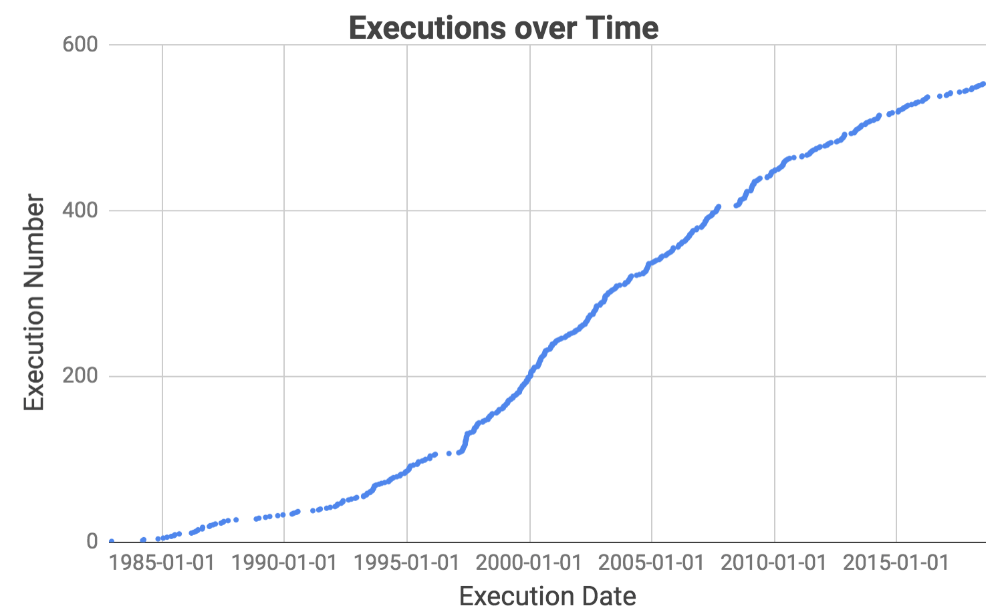
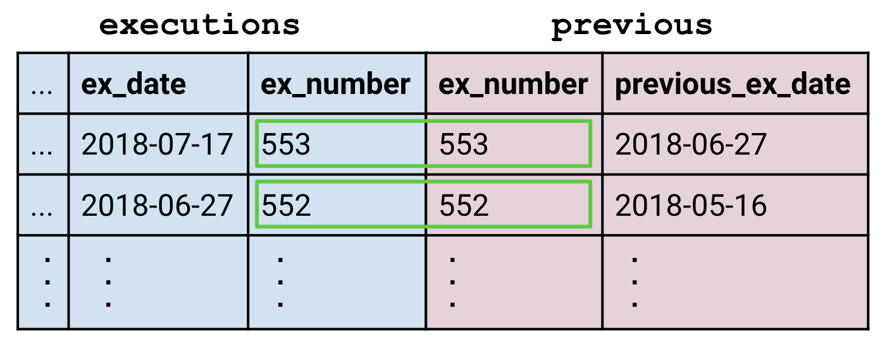
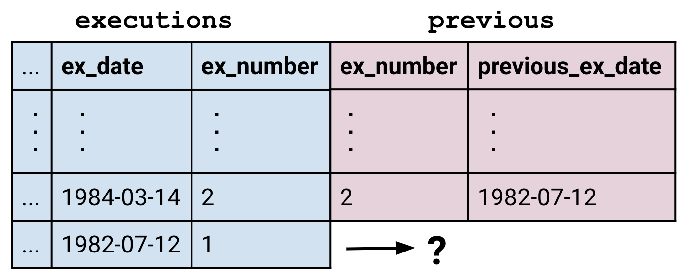
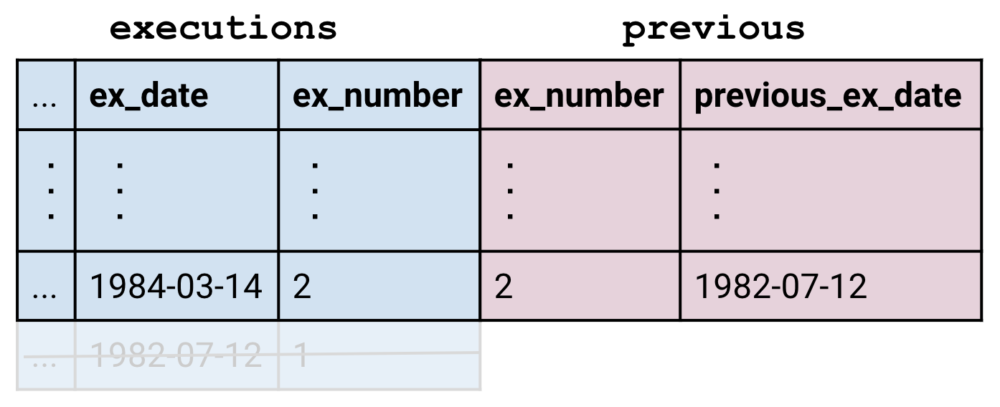
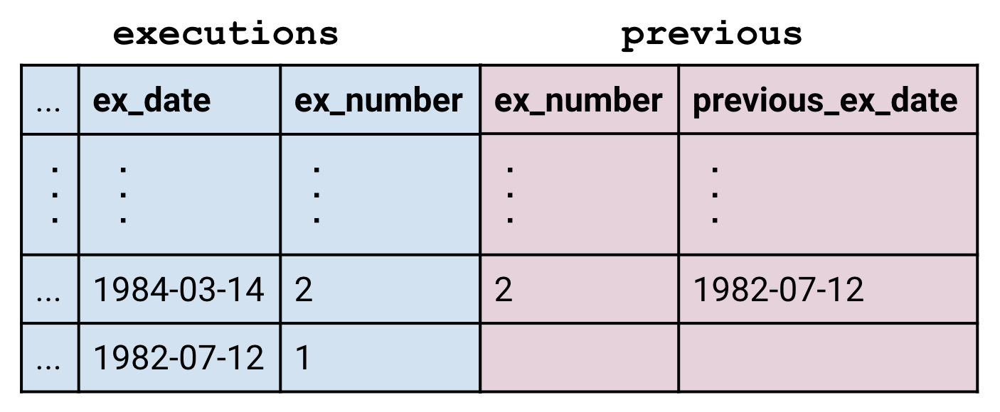
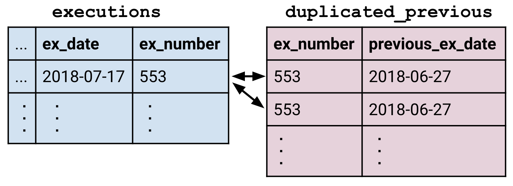
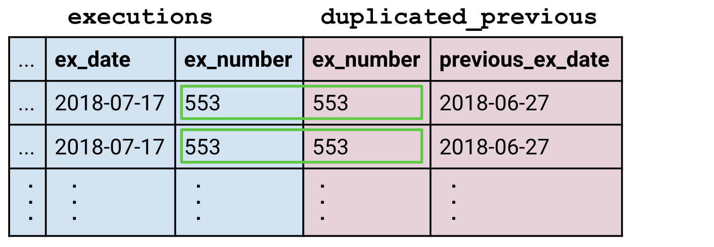
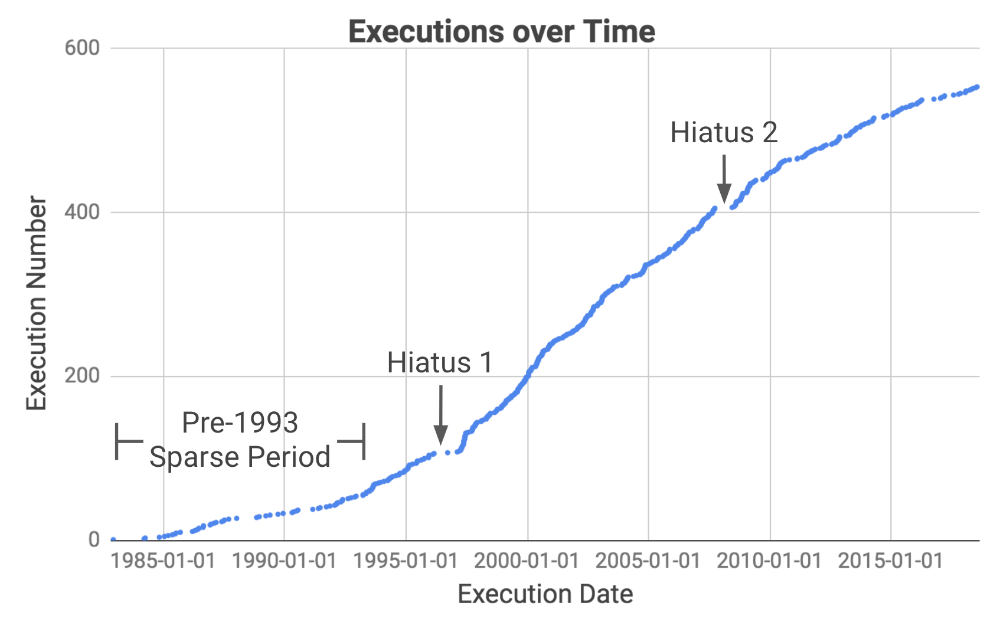

## Hiaten
Deze grafiek toont de executies door de tijd heen. Merk op dat er meerdere lange periodes zijn geweest waarin geen executies plaatsvonden. Ons doel is om uit te zoeken wanneer dat precies was en de oorzaken ervan te onderzoeken.

Onze strategie is om de tabel in een vorm te krijgen waarin elke rij ook de datum van de executie daarvoor bevat. We kunnen dan het tijdsverschil tussen de twee datums berekenen, ze in aflopende volgorde sorteren en de langste hiaten aflezen.

 

## Nadenken over joins
Geen van de technieken die we tot nu toe hebben geleerd volstaat hier. De tabel die we willen hebben, is even lang als de oorspronkelijke tabel `executions`, dus we kunnen aggregaties uitsluiten, omdat die een kleinere tabel opleveren. Het hoofdstuk over [Beazley](beazley.html) leerde ons alleen bewerkingen op rijen, en die beperken ons tot informatie die al in de rijen staat. De datum van de vorige executie ligt echter buiten de rij, dus we moeten `JOIN` gebruiken om de extra informatie binnen te halen.

Stel dat de extra informatie die we willen hebben in een tabel met de naam `previous` staat, met twee kolommen `(ex_number, last_ex_date)`. Dan zouden we de volgende query kunnen uitvoeren om onze taak te voltooien:

    SELECT
      last_ex_date AS start,
      ex_date AS end,
      ex_date - last_ex_date AS day_difference
    FROM executions
    JOIN previous
      ON executions.ex_number = previous.ex_number
    ORDER BY day_difference DESC
    LIMIT 10

Het `JOIN`-blok staat centraal in dit hoofdstuk. In plaats van het als een losse regel te zien, is het vaak handig om er zo naar te kijken:  Dit benadrukt hoe `JOIN` een grote gecombineerde tabel maakt, die vervolgens net als elke andere tabel aan het `FROM`-blok wordt doorgegeven.

  <h3>Kolommen ondubbelzinnig maken</h3>
  
De bovenstaande query is ook opmerkelijk omdat de voorwaarde <code>executions.ex_number = previous.ex_number</code> de vorm <code>&lt;tabel&gt;.&lt;kolom&gt;</code> gebruikt om kolommen aan te duiden. Dat is hier alleen nodig omdat beide tabellen een kolom met de naam <code>ex_number</code> hebben.

 
<a name="join_types">
## Soorten joins
Het `JOIN`-blok heeft de vorm <code class='codeblock'>&lt;tabel1&gt; JOIN &lt;tabel2&gt; ON &lt;voorwaarde&gt;</code>. De voorwaarde werkt op dezelfde manier als in <code class='codeblock'>WHERE &lt;voorwaarde&gt;</code>. Dat wil zeggen: het is een bewering die als waar of onwaar wordt geëvalueerd, en telkens wanneer een rij uit de eerste tabel en een rij uit de tweede tabel de voorwaarde waar maken, worden de twee aan elkaar gekoppeld:

Maar wat gebeurt er met rijen waarvoor geen overeenkomst is? In dit geval had de tabel `previous` geen rij voor executie nummer 1, omdat er geen executies aan voorafgingen.

 Het commando <code>JOIN</code> voert standaard een zogenaamde "inner join" uit, waarbij rijen zonder overeenkomst worden weggelaten.

Om alle rijen van de linkertabel te behouden, gebruiken we een <code>LEFT JOIN</code> in plaats van de gewone <code>JOIN</code>. De lege delen van de rij worden met rust gelaten, wat betekent dat ze de waarde <code>NULL</code> krijgen.

Met <code>RIGHT JOIN</code> kun je rijen zonder overeenkomst in de rechtertabel behouden, en met <code>OUTER JOIN</code> rijen zonder overeenkomst in beide tabellen.

De laatste subtiliteit is hoe meerdere overeenkomsten worden afgehandeld. Stel dat we een tabel `duplicated_previous` hebben die van elke rij van de tabel `previous` twee kopieën bevat. Elke rij van `executions` komt nu overeen met twee rijen in `duplicated_previous`.

De join maakt genoeg rijen van `executions` aan, zodat elke overeenkomende rij van `duplicated_previous` een eigen partner krijgt. Op deze manier kunnen joins tabellen opleveren die groter zijn dan de tabellen waaruit ze bestaan.

<sql-quiz
  data-title="Markeer de beweringen die waar zijn."
  data-description="Stel dat we tableA hebben met 3 rijen en tableB met 5 rijen.">
  <sql-quiz-option
    data-value="cartesian_prod"
    data-statement="<code>tableA JOIN tableB ON 1</code> geeft 15 rijen terug."
    data-hint="De voorwaarde <code>ON 1</code> is altijd waar, dus elke rij van tableA wordt gekoppeld aan elke rij van tableB."
    data-correct="true"></sql-quiz-option>
  <sql-quiz-option
    data-value="bad_cartesian"
    data-statement="<code>tableA JOIN tableB ON 0</code> geeft 0 rijen terug."
    data-hint="Om dezelfde reden waarom <code>ON 1</code> 15 rijen teruggeeft."
    data-correct="true"></sql-quiz-option>
  <sql-quiz-option
    data-value="left_join_bad"
    data-statement="<code>tableA LEFT JOIN tableB ON 0</code> geeft 3 rijen terug."
    data-hint="De left join behoudt alle rijen van tableA, ook al komt geen enkele rij van tableB overeen."
    data-correct="true"></sql-quiz-option>
  <sql-quiz-option
    data-value="outer_join_bad"
    data-statement="<code>tableA OUTER JOIN tableB ON 0</code> geeft 8 rijen terug."
    data-hint="De outer join behoudt alle rijen van tableA en tableB, ook al wordt geen enkele rij gekoppeld."
    data-correct="true"></sql-quiz-option>
  <sql-quiz-option
    data-value="outer_join_good"
    data-statement="<code>tableA OUTER JOIN tableB ON 1</code> geeft 15 rijen terug."
    data-hint="Door de voorwaarde <code>on 1</code> komen alle rijen van tableA overeen met alle rijen van tableB, dus elke soort join geeft 15 rijen terug. De verschillende joins verschillen alleen in hoe ze omgaan met rijen zonder overeenkomst."
    data-correct="true"></sql-quiz-option>
</sql-quiz>

 

## Datums
Laten we de joins even laten rusten en kijken naar deze regel in onze sjabloonquery:

      ex_date - last_ex_date AS day_difference

We zijn er zomaar van uitgegaan dat we datums van elkaar kunnen aftrekken. Maar stel je voor dat jij de computer bent die een regel als deze ontvangt. Geef je dan het aantal dagen tussen de datums terug? Waarom geen uren of seconden? Om het nog erger te maken, heeft SQLite eigenlijk geen datum- of tijdtypes (in tegenstelling tot de meeste andere SQL-dialecten), dus de kolommen `ex_date` en `last_ex_date` zien er voor jou uit als gewone tekenreeksen. Je wordt in feite gevraagd om `'hello' - 'world'` uit te rekenen. Wat zou dat überhaupt moeten betekenen?

Gelukkig bevat SQLite een heleboel functies waarmee je de computer kunt vertellen: "Hé, deze tekenreeksen die ik je geef, bevatten eigenlijk datums of tijden. Behandel ze zoals je een datum zou behandelen."

<sql-exercise
 data-question='Zoek in <a href="https://www.sqlite.org/lang_datefunc.html">de documentatie</a> hoe je de query kunt verbeteren zodat hij het aantal dagen tussen de datums teruggeeft.'
 data-default-text="SELECT '1993-08-10' - '1989-07-07' AS day_difference"
 data-solution="
SELECT JULIANDAY('1993-08-10') - JULIANDAY('1989-07-07') AS day_difference"
></sql-exercise>

 

## Self joins
Met wat we over datums hebben geleerd, kunnen we onze sjabloonquery verbeteren:

    SELECT
      last_ex_date AS start,
      ex_date AS end,
      JULIANDAY(ex_date) - JULIANDAY(last_ex_date)
        AS day_difference
    FROM executions
    JOIN previous
      ON executions.ex_number = previous.ex_number
    ORDER BY day_difference DESC
    LIMIT 5

De volgende stap is het opbouwen van de tabel `previous`.
<sql-exercise
  data-question="Schrijf een query die de tabel <code>previous</code> oplevert."
  data-comment="Vergeet niet aliassen te gebruiken om de kolomnamen <code>(ex_number, last_ex_date)</code> te vormen. Tip: in plaats van de datums naar achteren te schuiven, kun je ook <code>ex_number</code> naar voren schuiven!"
  data-solution="
SELECT
  ex_number + 1 AS ex_number,
  ex_date AS last_ex_date
FROM executions
WHERE ex_number < 553"></sql-exercise>

Nu kunnen we deze query nesten in ons sjabloon hierboven:
<sql-exercise
  data-question="Nest de query die de tabel <code>previous</code> genereert in het sjabloon."
  data-comment='Merk op dat we hier een tabelalias gebruiken: we noemen het resultaat van de geneste query "previous".'
  data-default-text="SELECT
  last_ex_date AS start,
  ex_date AS end,
  JULIANDAY(ex_date) - JULIANDAY(last_ex_date)
    AS day_difference
FROM executions
JOIN (<your-query>) previous
  ON executions.ex_number = previous.ex_number
ORDER BY day_difference DESC
LIMIT 10"
  data-solution="
SELECT
  last_ex_date AS start,
  ex_date AS end,
  JULIANDAY(ex_date) - JULIANDAY(last_ex_date) AS day_difference
FROM executions
JOIN (
    SELECT
      ex_number + 1 AS ex_number,
      ex_date AS last_ex_date
    FROM executions
  ) previous
  ON executions.ex_number = previous.ex_number
ORDER BY day_difference DESC
LIMIT 10"
></sql-exercise>

`previous` is afgeleid van `executions`, dus in feite koppelen we `executions` aan zichzelf. Dit heet een "self join" en is een krachtige techniek waarmee rijen informatie kunnen halen uit andere delen van dezelfde tabel.

We hebben de tabel `previous` gemaakt om duidelijk te maken welk doel hij dient. Maar we kunnen de query eigenlijk eleganter schrijven door de tabel `executions` rechtstreeks aan zichzelf te koppelen.
<sql-exercise
  data-question="Vul de <code>JOIN ON</code>-voorwaarde in om een elegantere versie van de vorige query te maken."
  data-comment="Merk op dat we één kopie nog steeds een alias moeten geven, zodat we er ondubbelzinnig naar kunnen verwijzen."
  data-default-text="SELECT
  previous.ex_date AS start,
  executions.ex_date AS end,
  JULIANDAY(executions.ex_date) - JULIANDAY(previous.ex_date)
    AS day_difference
FROM executions
JOIN executions previous
  ON <your-clause>
ORDER BY day_difference DESC
LIMIT 10"
  data-solution="
SELECT
  previous.ex_date AS start,
  executions.ex_date AS end,
  JULIANDAY(executions.ex_date) - JULIANDAY(previous.ex_date)
    AS day_difference
FROM executions
JOIN executions previous
  ON executions.ex_number = previous.ex_number + 1
ORDER BY day_difference DESC
LIMIT 10"
></sql-exercise>

We kunnen nu de precieze datums van de hiaten gebruiken om te onderzoeken wat er in elke periode is gebeurd. In de jaren direct nadat het verbod op de doodstraf was opgeheven, waren er lange periodes zonder executies, door het lage aantal doodvonnissen en de juridische aanvechtingen van de nieuwe uitspraak. We laten de onderbrekingen van vóór 1993 daarom buiten beschouwing en richten ons op de twee grote hiaten sindsdien.

Hiaat 1 werd veroorzaakt door juridische aanvechtingen van de <a href="https://en.wikipedia.org/wiki/Antiterrorism_and_Effective_Death_Penalty_Act_of_1996">Antiterrorism and Effective Death Penalty Act van 1996</a>, die werd ingevoerd als reactie op de bomaanslagen op het World Trade Center in 1993 en in Oklahoma City in 1995. De wet beperkte de beroepsmogelijkheden om de doodstraf effectiever te maken, vooral in terrorismezaken (<a href="https://deathpenaltyinfo.org/documents/1996YearEndRpt.pdf">Bron</a>).

Hiaat 2 werd veroorzaakt door een opschorting die het Hooggerechtshof instelde terwijl het zich boog over <a href="https://en.wikipedia.org/wiki/Baze_v._Rees">Baze v. Rees</a>, een zaak waarin werd onderzocht of de dodelijke injectie in strijd is met het Achtste Amendement, dat "wrede en ongebruikelijke straffen" verbiedt. Dit had gevolgen voor executies in heel Amerika, omdat de meeste staten dezelfde medicijncocktail gebruikten als Kentucky. Het Hooggerechtshof bevestigde uiteindelijk de uitspraak van de rechtbank in Kentucky, en een paar maanden later werden de executies in Texas hervat.

 

## Samenvatting

Het grote idee achter `JOIN`s is het maken van een uitgebreide tabel, omdat de oorspronkelijke tabel niet de informatie bevatte die we nodig hadden. Dit is een krachtig concept, omdat het ons bevrijdt van de beperkingen van één enkele tabel en ons in staat stelt meerdere tabellen op mogelijk complexe manieren te combineren. We hebben ook gezien dat met deze extra complexiteit een nauwgezette boekhouding belangrijk wordt. Tabellen een alias geven, kolommen hernoemen en goede `JOIN ON`-voorwaarden opstellen zijn allemaal technieken die ons helpen de orde te bewaren.
