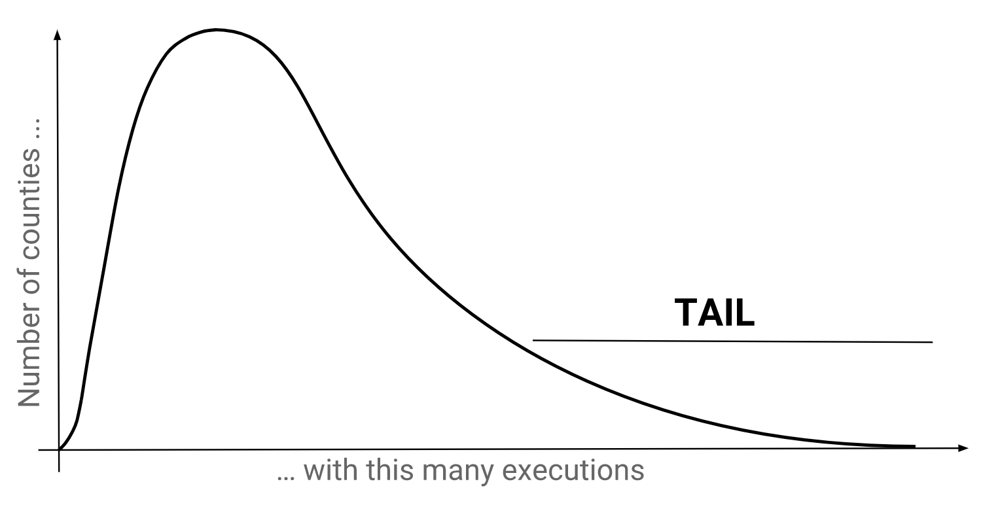

## Lange staarten
Een lange staart verwijst naar een klein aantal waarnemingen die een groot aantal keren voorkomen. Wanneer we deze in een grafiek uitzetten, vormen ze een smalle strook ver rechts van het zwaartepunt, die eruitziet als een staart. Ze wijzen op de aanwezigheid van uitschieters waarvan het ongewone gedrag interessant voor ons kan zijn. In de context van executies in Texas verwijst de lange staart naar een klein aantal counties waarvan bekend is dat ze een groot aantal executies hebben uitgevoerd.

Laten we voor elke county het percentage van de executies bepalen, zodat we de counties in de staart eruit kunnen pikken.

Zoals steeds duidelijker zal worden, vertelt de vorm van de tabellen ons veel over de bewerkingen die we moeten uitvoeren. (Dit is vergelijkbaar met dimensieanalyse in de natuurkunde.) In dit geval kunnen we vaststellen dat de methoden die we tot nu toe hebben behandeld ontoereikend zijn: het hoofdstuk over [Beazley](beazley.html) ging over afzonderlijke rijen gegevens, maar het is duidelijk dat we moeten aggregeren om gegevens op countyniveau te krijgen. Het hoofdstuk [Beweringen van onschuld](innocence.html) leerde ons aggregeren, maar die functies zouden de hele dataset samenvoegen tot één rij, terwijl we eigenlijk één rij per county willen.

 

## Het GROUP BY-blok
Hier komt het `GROUP BY`-blok om de hoek kijken. Hiermee kunnen we de dataset opsplitsen en binnen elke groep aggregatiefuncties toepassen, wat resulteert in één rij per groep. De meest eenvoudige vorm is <code class="codeblock">GROUP BY &lt;kolom&gt;, &lt;kolom&gt;, ...</code> en het komt na het `WHERE`-blok.

<sql-exercise
  data-question="Deze query haalt het aantal executies per county op."
  data-default-text="SELECT
  county,
  COUNT(*) AS county_executions
FROM executions
GROUP BY county"></sql-exercise>

Als je je <a href='innocence.html#strange'>Een vreemde query</a> herinnert, zouden er nu alarmbellen moeten afgaan in je hoofd. Hadden we niet net geleerd om geaggregeerde en niet-geaggregeerde kolommen niet te mengen? Het verschil hier is dat groeperingskolommen de enige kolommen zijn die niet geaggregeerd hoeven te worden. Alle rijen in een groep hebben immers dezelfde waarden in die kolommen, dus er is geen onduidelijkheid over de waarde die moet worden teruggegeven.

Je hebt misschien ook ons gebruik van `AS` opgemerkt. Dit noemen we "aliasing". In het `SELECT`-blok geeft <code class="codeblock">&lt;expressie&gt; AS &lt;alias&gt;</code> een alias waarnaar later in de query kan worden verwezen. Dit bespaart ons het herhalen van lange expressies en stelt ons in staat om het doel van de expressie te verduidelijken.

<sql-exercise
  data-question="Deze query telt de executies met en zonder laatste verklaring. Pas de query aan om deze aantallen verder uit te splitsen per county."
  data-comment="De voorwaarde <code>last_statement IS NOT NULL</code> werkt als een indicatorvariabele, waarbij 1 waar betekent en 0 onwaar."
  data-default-text="SELECT
  last_statement IS NOT NULL AS has_last_statement,
  COUNT(*)
FROM executions
GROUP BY has_last_statement"
  data-solution="SELECT
  last_statement IS NOT NULL AS has_last_statement,
  county,
  COUNT(*)
FROM executions
GROUP BY has_last_statement, county"
  ></sql-exercise>

 

## Het HAVING-blok
De volgende oefening laat zien dat het filteren via het `WHERE`-blok plaatsvindt vóór het groeperen en aggregeren. Dit is terug te zien in de volgorde van de syntaxis, want het `WHERE`-blok komt altijd vóór het `GROUP BY`-blok.

<sql-exercise
  data-question="Tel per county het aantal gevangenen van 50 jaar of ouder dat is geëxecuteerd."
  data-comment="Je zou dit met <code>CASE WHEN</code> moeten kunnen doen, maar probeer hier het <code>WHERE</code>-blok te gebruiken."
  data-default-text=""
  data-solution="SELECT county, COUNT(*)
FROM executions
WHERE ex_age >= 50
GROUP BY county"
  ></sql-exercise>

Dit is allemaal goed en wel, maar wat als we willen filteren op het resultaat van het groeperen en aggregeren? We kunnen toch niet vooruitspringen in de tijd en daar informatie vandaan halen. Om dit probleem op te lossen, gebruiken we `HAVING`.

<sql-exercise
  data-question="Geef een lijst van de counties waarin meer dan 2 gevangenen van 50 jaar of ouder zijn geëxecuteerd."
  data-comment="Dit bouwt voort op de vorige oefening. We hebben een extra filter nodig&mdash;een die het resultaat van de aggregatie gebruikt. Dat betekent dat dit filter niet in het <code>WHERE</code>-blok kan staan, omdat die filters vóór de aggregatie worden uitgevoerd. Zoek het <a href='https://www.w3schools.com/sql/sql_having.asp'><code>HAVING</code>-blok</a> op. Je kunt het zien als een <code>WHERE</code>-blok dat na de aggregatie wordt toegepast."
  data-default-text=""
  data-solution="
SELECT county
FROM executions
WHERE ex_age >= 50
GROUP BY county
HAVING COUNT(*) > 2"
  ></sql-exercise>

 
## Oefenen
Deze quiz is bedoeld om je begrip op de proef te stellen. Lees de uitleg, ook als je alles goed hebt.

<sql-quiz
  data-title="Markeer de beweringen die waar zijn."
  data-description="Deze query bepaalt het aantal gevangenen per county en per leeftijdscategorie van 10 jaar. <pre>
SELECT
  county,
  ex_age/10 AS decade_age,
  COUNT(*)
FROM executions
GROUP BY county, decade_age</pre>">
  <sql-quiz-option
    data-value="valid"
    data-statement="De query is geldig (d.w.z. hij geeft geen foutmelding bij het uitvoeren)."
    data-hint="Liet je je in de war brengen door <code>ex_age/10</code>? Groeperen op getransformeerde kolommen is ook prima."
    data-correct="true"></sql-quiz-option>
  <sql-quiz-option
    data-value="gran"
    data-statement="De query zou meer rijen teruggeven als we <code>ex_age</code> zouden gebruiken in plaats van <code>ex_age/10</code>."
    data-hint="Onthoud dat <code>ex_age/10</code> een gehele deling uitvoert, waardoor alle leeftijden worden afgerond. Dit levert minder unieke groepen op."
    data-correct="true"></sql-quiz-option>
  <sql-quiz-option
    data-value="unique_combocc"
    data-statement="De uitvoer heeft evenveel rijen als er unieke combinaties van counties en decade_ages in de dataset zijn."
    data-hint="Dit klopt."
    data-correct="true"></sql-quiz-option>
  <sql-quiz-option
    data-statement="De uitvoer bevat een groep ('Bexar', 6), ook al was geen enkele gevangene uit Bexar County tussen de 60 en 69 jaar oud op het moment van executie."
    data-hint="Het <code>GROUP BY</code>-blok vindt alle combinaties <i>in de dataset</i> en niet alle theoretisch mogelijke combinaties."
    data-value="abstract_cartesian"></sql-quiz-option>
  <sql-quiz-option
    data-statement="De uitvoer heeft voor elke rij die wordt teruggegeven een andere waarde voor county."
    data-hint="Dit zou alleen waar zijn als <code>county</code> de enige groeperingskolom was. Hier kunnen we veel groepen hebben met dezelfde county maar verschillende decade_ages."
    data-value="one_col_diff"></sql-quiz-option>
  <sql-quiz-option
    data-statement="De uitvoer kan groepen bevatten waarvan het aantal 0 is."
    data-hint="Dit lijkt op de vraag over ('Bexar', 6). Als er geen rijen zijn met ('Bexar', 6), verschijnt de groep niet eens."
    data-value="count_zero"></sql-quiz-option>
  <sql-quiz-option
    data-statement="De query zou ook geldig zijn als we <code>county</code> niet in het <code>SELECT</code>-blok opnemen."
    data-hint="De groeperingskolommen hoeven niet per se in het <code>SELECT</code>-blok te staan. De query zou geldig zijn, maar weinig zin hebben, omdat we dan niet zouden weten welke aantallen bij welke county horen."
    data-value="missing_gp_col"
    data-correct="true"></sql-quiz-option>
  <sql-quiz-option
    data-statement="Het is redelijk om <code>last_name</code> aan het <code>SELECT</code>-blok toe te voegen, zelfs zonder erop te groeperen."
    data-hint="Hoewel dit (in SQLite) geldig zou zijn om de redenen die zijn uitgelegd in <a href='innocence.html#strange'>Een vreemde query</a>, is het slechte stijl om niet-geaggregeerde kolommen waarop niet gegroepeerd wordt in het <code>SELECT</code>-blok op te nemen."
    data-value="extra_gp_col"></sql-quiz-option>
</sql-quiz>

<sql-exercise
  data-question="Geef een lijst van alle verschillende counties in de dataset."
  data-comment="We hebben dit in het vorige hoofdstuk gedaan met het commando <code>SELECT DISTINCT</code>. Houd het deze keer bij een gewone <code>SELECT</code> en gebruik <code>GROUP BY</code>."
  data-default-text=""
  data-solution="SELECT county FROM executions GROUP BY county"
  ></sql-exercise>

 

## Geneste queries
Nu vraag je je misschien af: zouden we niet klaar zijn als we gewoon zoiets als dit konden uitvoeren?

    SELECT
      county,
      PERCENT_COUNT(*)
    FROM executions
    GROUP BY county

Percentages zijn zo'n veelgebruikte maatstaf&mdash;zou zo'n functie niet moeten bestaan? Helaas niet, en misschien met goede reden: zo'n functie zou zowel binnen de groepen moeten aggregeren (om de teller te krijgen) als over de hele dataset (om de noemer te krijgen). Maar een query heeft óf een `GROUP BY`-blok, óf niet. Wat we dus echt nodig hebben, zijn twee aparte queries: een die aggregeert met een `GROUP BY` en een andere die aggregeert zonder. Die kunnen we vervolgens combineren met een techniek die "nesten" heet.

Hier is een voorbeeld van hoe nesten werkt. De haakjes zijn belangrijk om de grens aan te geven tussen de binnenste query en de buitenste:

<sql-exercise
  data-question="Bepaal de voor- en achternaam van de gevangene met de langste laatste verklaring (in aantal tekens)."
  data-comment="Schrijf een geschikte query om te nesten op de plaats van &lt;<code>length-of-longest-last-statement</code>&gt;."
  data-default-text="SELECT first_name, last_name
FROM executions
WHERE LENGTH(last_statement) =
    (<length-of-longest-last-statement>)"
  data-solution="SELECT first_name, last_name
FROM executions
WHERE LENGTH(last_statement) =
    (SELECT MAX(LENGTH(last_statement))
     FROM executions)"></sql-exercise>

Nogmaals: nesten is hier nodig omdat de computer in de `WHERE`-voorwaarde, terwijl hij een rij inspecteert om te beslissen of de laatste verklaring de juiste lengte heeft, niet buiten die rij kan kijken om de maximale lengte over de hele dataset te bepalen. We moeten de maximale lengte apart bepalen en die aan de voorwaarde doorgeven. Laten we nu hetzelfde concept toepassen om per county het percentage executies te bepalen.

<sql-exercise
  data-question="Vul de query &lt;<code>count-of-all-rows</code>&gt; in om per county het percentage executies te bepalen."
  data-comment="<code>100.0</code> is een decimaal getal, zodat we decimale percentages krijgen."
  data-default-text="SELECT
  county,
  100.0 * COUNT(*) / (<count-of-all-rows>)
    AS percentage
FROM executions
GROUP BY county
ORDER BY percentage DESC"
  data-solution="SELECT
  county,
  100.0 * COUNT(*) / (SELECT COUNT(*) FROM executions)
    AS percentage
FROM executions
GROUP BY county
ORDER BY percentage DESC"
  ></sql-exercise>

Ik heb er stilletjes een `ORDER BY`-blok tussen gestopt. De vorm is <code class="codeblock">ORDER BY &lt;kolom&gt;, &lt;kolom&gt;, ...</code> en je kunt het aanpassen door `DESC` toe te voegen als je niet de standaard oplopende volgorde wilt.

 

## Harris County
Is het verrassend dat Harris (waar de stad Houston ligt), Dallas, Bexar en Tarrant samen goed zijn voor ongeveer 50% van alle executies in Texas? Misschien wel, vooral als we ervan uitgaan dat executies gelijk over de counties verdeeld zouden moeten zijn. Maar een betere eerste benadering is dat executies verdeeld zijn in verhouding tot de bevolking. De [volkstelling van Texas uit 2010](https://www.tsl.texas.gov/ref/abouttx/popcnty12010.html) laat zien dat de 4 counties samen 10,0 miljoen inwoners hadden, wat 40,0% is van de bevolking van Texas (25,1 miljoen). Dat maakt de bevinding iets minder verrassend.

Maar als we deze staart verder uitsplitsen, zien we dat Harris County verantwoordelijk is voor het grootste deel van het verschil. De county heeft slechts 16,4% van de bevolking, maar 23,1% van de executies. Dat is bijna 50% meer dan je zou verwachten.

Talloze studies hebben onderzocht waarom Harris County zo productief is geweest, en er zijn verschillende factoren aangedragen:
 - 
De vervolging is <a href="https://web.archive.org/web/20191227235319/https://www.citylab.com/equity/2014/09/one-texas-county-is-responsible-for-most-of-the-executions-in-the-entire-us/380705/">goed georganiseerd en ruim gefinancierd</a>, terwijl de verdediging door de rechtbank wordt betaald en weinig prikkels heeft. <a href="https://houstonlawreview.org/article/3874.pdf">(Bron, zie p49)</a>
 - 
De officier van justitie die er lange tijd zat, was <a href="https://www.chron.com/news/houston-texas/article/Former-DA-ran-powerful-death-penalty-machine-1833545.php">vastberaden en enthousiast over de doodstraf</a>.
 - 
Rechters in Texas worden gekozen, en de bevolking steunt de doodstraf. <a href="https://priceonomics.com/why-has-texas-executed-so-many-inmates/">(Bron)</a>
 - 
Het systeem van checks and balances in de rechtspraak van Harris County heeft niet gewerkt. <a href="https://houstonlawreview.org/article/3874-the-problem-of-rubber-stamping-in-state-capital-habeas-proceedings-a-harris-county-case-study">(Bron, zie p929)</a>

 

## Samenvatting
In dit hoofdstuk hebben we geleerd om over groepen te aggregeren en om met nesten de uitvoer van een binnenste query te gebruiken in een buitenste query. Deze technieken hebben het zeer praktische voordeel dat we er percentages mee kunnen berekenen.

  <h3>MapReduce</h3>
  
Een interessante kanttekening is dat we eigenlijk net hebben geleerd hoe je MapReduce in SQL doet. MapReduce is een bekend programmeerparadigma dat berekeningen opvat als een "map"-stap en een "reduce"-stap. Je kunt <a href="https://stackoverflow.com/questions/28982/simple-explanation-of-mapreduce">hier</a> meer leren over MapReduce.

  
Het hoofdstuk over <a href="beazley.html">Beazley</a> ging helemaal over mappen, omdat het ons liet zien hoe we allerlei bewerkingen op alle rijen kunnen toepassen. <code>SELECT LENGTH(last_statement) FROM executions</code> past bijvoorbeeld de lengtefunctie toe op alle rijen. Dit hoofdstuk liet ons zien hoe we groepen gegevens kunnen reduceren met aggregatiefuncties; en het vorige hoofdstuk, <a href="innocence.html">Beweringen van onschuld</a>, was slechts een speciaal geval waarin de hele tabel één groep vormt.

In het volgende hoofdstuk leren we over `JOIN`s, waarmee we met meerdere tabellen kunnen werken.
