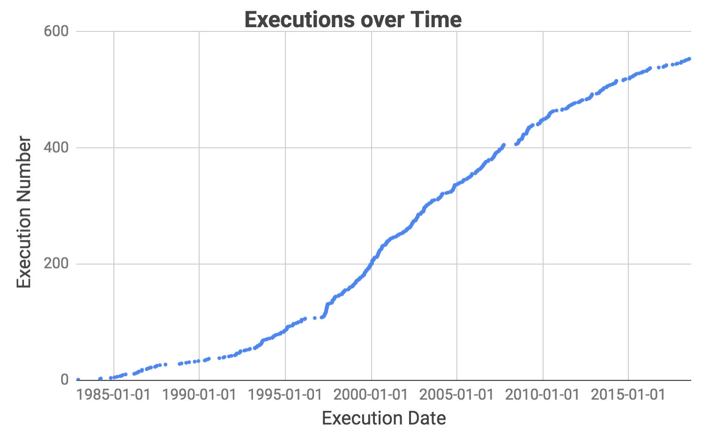
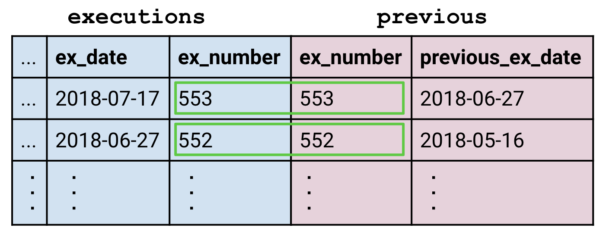
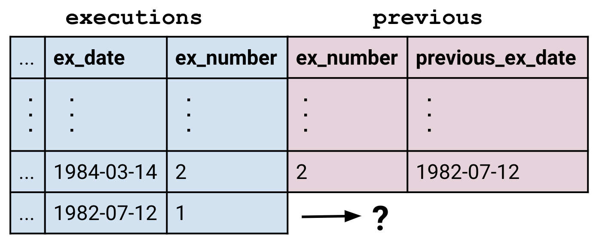
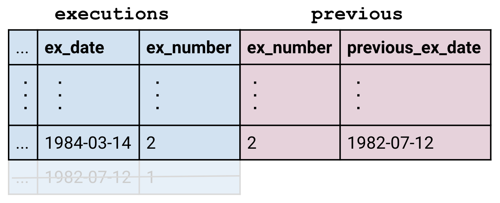
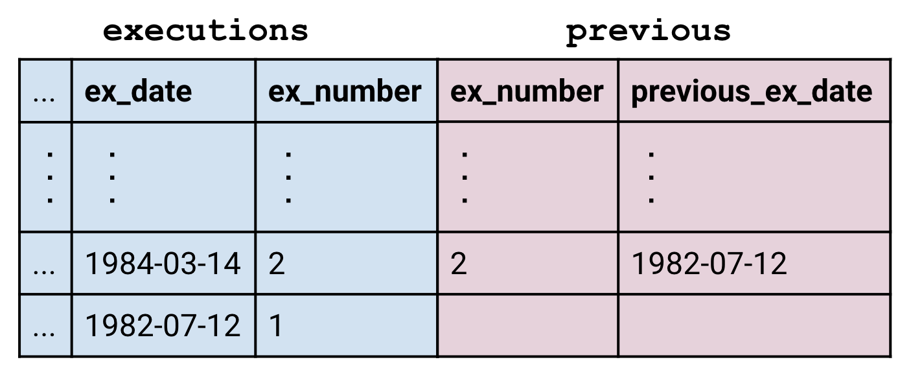
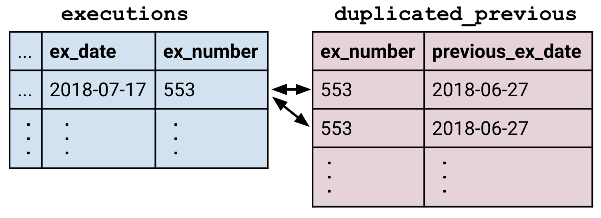
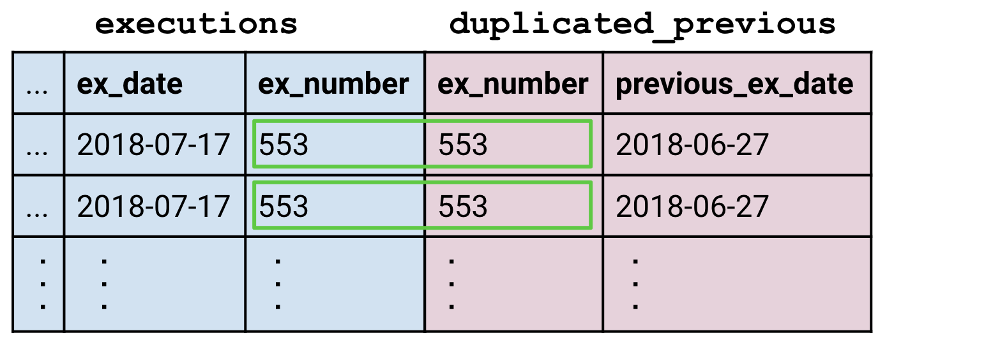
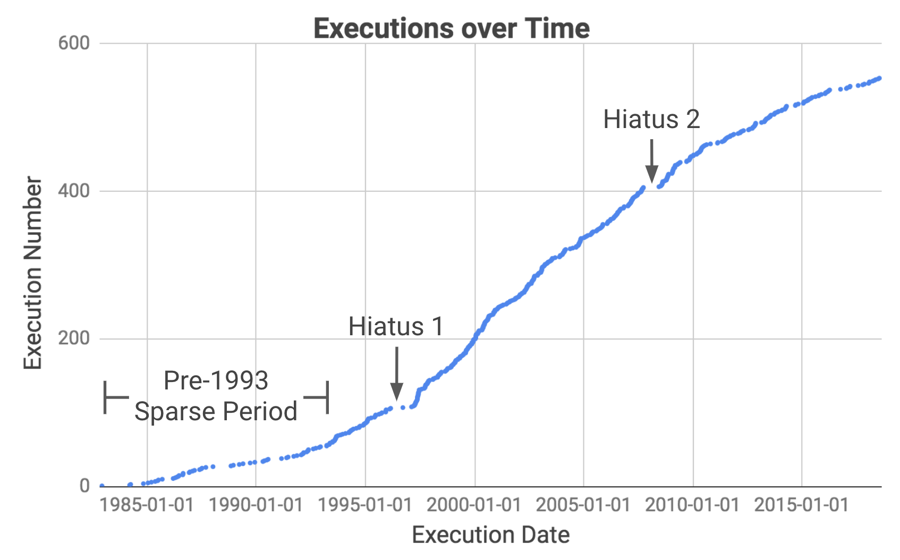

## Перерви
Цей графік показує, як відбувалися страти з плином часу. Зверніть увагу на кілька тривалих періодів, коли страт не було. Наше завдання — точно визначити ці проміжки й дослідити їхні причини.

Наш план — доповнити кожен рядок таблиці датою попередньої страти. Потім обчислимо різницю між двома датами, відсортуємо її за спаданням і знайдемо найдовші перерви.

 

## Як розуміти з’єднання таблиць
Жоден із вивчених прийомів сам собою не розв’язує цю задачу. Ми хочемо доповнити початкові рядки `executions`, а не згорнути їх у меншу кількість агрегованих рядків. У розділі [«Останні слова Бізлі»](beazley.html) ми працювали лише з інформацією всередині окремого рядка. Але дата попередньої страти міститься в іншому рядку, тому для її додавання скористаємося `JOIN`.

Припустімо, що потрібна додаткова інформація вже є в таблиці `previous` зі стовпцями `(ex_number, last_ex_date)`. Тоді основа розв’язку могла б виглядати так:

    SELECT
      last_ex_date AS start,
      ex_date AS end,
      ex_date - last_ex_date AS day_difference
    FROM executions
    JOIN previous
      ON executions.ex_number = previous.ex_number
    ORDER BY day_difference DESC
    LIMIT 10

У цьому розділі нас цікавить `JOIN`. Замість того щоб сприймати її, як окремий рядок запиту, корисно дивитися на неї так:  `JOIN` створює спільну таблицю, яку `FROM` використовує як джерело даних — так само, як будь-яку іншу таблицю.

  <h3>Однозначні посилання на стовпці</h3>
  
Зверніть увагу на умову <code>executions.ex_number = previous.ex_number</code>. Тут використано формат <code>&lt;таблиця&gt;.&lt;стовпець&gt;</code>, щоб однозначно вказати потрібний стовпець: обидві таблиці мають стовпець <code>ex_number</code>.

 

## Типи з’єднань
З’єднання має форму <code class='codeblock'>&lt;таблиця1&gt; JOIN &lt;таблиця2&gt; ON &lt;умова&gt;</code>. Умова працює за тим самим принципом, що й у <code class='codeblock'>WHERE &lt;умова&gt;</code>: вона може бути істинною або хибною. Якщо для пари рядків із двох таблиць умова істинна, ці рядки утворюють пару в результаті:

Що відбувається з рядками, для яких немає відповідності? У нашому прикладі таблиця `previous` не має запису для страти № 1, адже попередньої страти в наборі даних немає.

За замовчуванням <code>JOIN</code> означає <em>внутрішнє з’єднання</em> (INNER JOIN). Рядки без відповідностей у результат не потрапляють.

Щоб зберегти всі рядки лівої таблиці, використайте <code>LEFT JOIN</code> — <em>ліве зовнішнє з’єднання</em>. Для рядків без відповідностей стовпці правої таблиці матимуть значення <code>NULL</code>.

<code>RIGHT JOIN</code> — праве зовнішнє з’єднання — зберігає всі рядки правої таблиці. <code>FULL OUTER JOIN</code> — повне зовнішнє з’єднання — зберігає рядки без відповідностей з обох таблиць. Далі ці типи розглянуто концептуально: стара версія SQLite, вбудована в цей підручник, не підтримує RIGHT JOIN і FULL OUTER JOIN.

Ще одна тонкість — кілька відповідностей. Припустімо, що таблиця `duplicated_previous` містить по дві копії кожного рядка `previous`. Тоді кожному відповідному рядку `executions` відповідають два рядки `duplicated_previous`.

У результаті з’єднання створюється окремий рядок для кожної відповідної пари. Тому значення з `executions` повторюються для кожного відповідного рядка `duplicated_previous`. Отже, результат з’єднання може містити більше рядків, ніж будь-яка з початкових таблиць.

<sql-quiz
  data-title="Позначте правильні твердження."
  data-description="Припустімо, tableA містить 3 рядки, а tableB — 5. Питання про FULL OUTER JOIN стосуються його стандартної поведінки, а не підтримки у вбудованій версії SQLite.">
  <sql-quiz-option
    data-value="cartesian_prod"
    data-statement="<code>tableA JOIN tableB ON 1</code> повертає 15 рядків."
    data-hint="Умова <code>ON 1</code> завжди істинна, тому кожен рядок tableA утворює пару з кожним рядком tableB."
    data-correct="true"></sql-quiz-option>
  <sql-quiz-option
    data-value="bad_cartesian"
    data-statement="<code>tableA JOIN tableB ON 0</code> повертає 0 рядків."
    data-hint="Умова <code>ON 0</code> завжди хибна, тому жодна пара рядків не потрапить у результат внутрішнього з’єднання."
    data-correct="true"></sql-quiz-option>
  <sql-quiz-option
    data-value="left_join_bad"
    data-statement="<code>tableA LEFT JOIN tableB ON 0</code> повертає 3 рядки."
    data-hint="Ліве зовнішнє з’єднання зберігає всі рядки tableA, навіть якщо для них немає відповідностей у tableB."
    data-correct="true"></sql-quiz-option>
  <sql-quiz-option
    data-value="outer_join_bad"
    data-statement="<code>tableA FULL OUTER JOIN tableB ON 0</code> повертає 8 рядків."
    data-hint="Повне зовнішнє з’єднання зберігає всі рядки tableA і tableB, хоча жоден із них не має відповідності в іншій таблиці."
    data-correct="true"></sql-quiz-option>
  <sql-quiz-option
    data-value="outer_join_good"
    data-statement="<code>tableA FULL OUTER JOIN tableB ON 1</code> повертає 15 рядків."
    data-hint="Через умову <code>ON 1</code> кожен рядок tableA відповідає кожному рядку tableB. У цьому випадку всі розглянуті типи з’єднань повертають 15 рядків: відмінності між ними стосуються рядків без відповідностей."
    data-correct="true"></sql-quiz-option>
</sql-quiz>

 

## Дати
Ненадовго відкладемо з’єднання й розгляньмо цей рядок із нашого шаблону запиту:

      ex_date - last_ex_date AS day_difference

Ми зробили важливе припущення: що одну дату можна просто відняти від іншої. Але уявіть себе на місці комп’ютера. Потрібно повернути кількість днів? Чому не годин або секунд? До того ж SQLite, на відміну від багатьох інших систем, не має окремого типу зберігання для дат і часу. Тому значення `ex_date` та `last_ex_date` тут зберігаються як звичайний текст. Без спеціального перетворення це схоже на спробу обчислити `'hello' - 'world'`.

На щастя, SQLite має функції, які повідомляють системі: «Ці значення містять дати або час; опрацюй їх відповідно».

<sql-exercise
 data-question='Зверніться до <a href="https://www.sqlite.org/lang_datefunc.html">документації</a> та виправте запит, щоб він повертав кількість днів між датами.'
 data-default-text="SELECT '1993-08-10' - '1989-07-07' AS day_difference"
 data-solution="
SELECT JULIANDAY('1993-08-10') - JULIANDAY('1989-07-07') AS day_difference"
></sql-exercise>

 

## Самоз’єднання
Тепер, знаючи, як працювати з датами, можемо виправити шаблон запиту:

    SELECT
      last_ex_date AS start,
      ex_date AS end,
      JULIANDAY(ex_date) - JULIANDAY(last_ex_date)
        AS day_difference
    FROM executions
    JOIN previous
      ON executions.ex_number = previous.ex_number
    ORDER BY day_difference DESC
    LIMIT 5

Наступний крок — отримати таблицю `previous`.
<sql-exercise
  data-question="Напишіть запит, який формує таблицю <code>previous</code>."
  data-comment="Використайте псевдоніми, щоб отримати стовпці <code>(ex_number, last_ex_date)</code>. Підказка: замість того щоб зсувати дати назад, можна збільшити <code>ex_number</code> на один!"
  data-solution="
SELECT
  ex_number + 1 AS ex_number,
  ex_date AS last_ex_date
FROM executions
WHERE ex_number < 553"></sql-exercise>

Тепер вкладемо цей запит у наш шаблон:
<sql-exercise
  data-question="Вставте запит, який формує таблицю <code>previous</code>, у наведений шаблон."
  data-comment='Тут ми використовуємо псевдонім таблиці: результат підзапиту називаємо previous.'
  data-default-text="SELECT
  last_ex_date AS start,
  ex_date AS end,
  JULIANDAY(ex_date) - JULIANDAY(last_ex_date)
    AS day_difference
FROM executions
JOIN (<your-query>) previous
  ON executions.ex_number = previous.ex_number
ORDER BY day_difference DESC
LIMIT 10"
  data-solution="
SELECT
  last_ex_date AS start,
  ex_date AS end,
  JULIANDAY(ex_date) - JULIANDAY(last_ex_date) AS day_difference
FROM executions
JOIN (
    SELECT
      ex_number + 1 AS ex_number,
      ex_date AS last_ex_date
    FROM executions
  ) previous
  ON executions.ex_number = previous.ex_number
ORDER BY day_difference DESC
LIMIT 10"
></sql-exercise>

Таблиця `previous` походить із `executions`, тож фактично ми з’єднуємо `executions` із нею самою. Це називається <em>самоз’єднанням</em>. Такий прийом дає змогу доповнювати рядок даними з інших рядків тієї самої таблиці.

Окремий підзапит `previous` допоміг пояснити ідею. Але запит можна записати коротше, з’єднавши `executions` безпосередньо із самою собою.
<sql-exercise
  data-question="Заповніть умову після <code>JOIN ... ON</code>, щоб завершити компактніший варіант попереднього запиту."
  data-comment="Одному з двох посилань на таблицю все одно потрібен псевдонім, щоб однозначно звертатися до його стовпців."
  data-default-text="SELECT
  previous.ex_date AS start,
  executions.ex_date AS end,
  JULIANDAY(executions.ex_date) - JULIANDAY(previous.ex_date)
    AS day_difference
FROM executions
JOIN executions previous
  ON <your-clause>
ORDER BY day_difference DESC
LIMIT 10"
  data-solution="
SELECT
  previous.ex_date AS start,
  executions.ex_date AS end,
  JULIANDAY(executions.ex_date) - JULIANDAY(previous.ex_date)
    AS day_difference
FROM executions
JOIN executions previous
  ON executions.ex_number = previous.ex_number + 1
ORDER BY day_difference DESC
LIMIT 10"
></sql-exercise>

Тепер за точними датами перерв можна дослідити події тих періодів. У перші роки після скасування заборони на смертну кару тривалі перерви були пов’язані з невеликою кількістю смертних вироків і судовими оскарженнями нового порядку. Тому не розглядатимемо проміжки до 1993 року й зосередимося на двох великих перервах після нього.

Перша перерва була пов’язана із судовими оскарженнями <a href="https://en.wikipedia.org/wiki/Antiterrorism_and_Effective_Death_Penalty_Act_of_1996">Закону про боротьбу з тероризмом та ефективне застосування смертної кари 1996 року</a>, ухваленого після вибухів у Всесвітньому торговому центрі 1993 року й Оклахома-Сіті 1995 року. Закон обмежував процедури оскарження, щоб прискорити виконання смертних вироків, зокрема у справах про тероризм (<a href="https://deathpenaltyinfo.org/documents/1996YearEndRpt.pdf">джерело</a>).

Друга перерва виникла через зупинення виконання смертних вироків під час розгляду Верховним судом справи <a href="https://en.wikipedia.org/wiki/Baze_v._Rees">«Бейз проти Ріса»</a>. Суд з’ясовував, чи не порушує смертельна ін’єкція Восьму поправку, яка забороняє «жорстокі й незвичайні покарання». Це вплинуло на страти по всій країні, бо більшість штатів використовували ту саму комбінацію препаратів, що й Кентуккі. Зрештою Верховний суд залишив рішення суду Кентуккі в силі, і через кілька місяців страти в Техасі відновилися.

 

## Підсумок

Головна ідея `JOIN` — отримати доповнену таблицю, коли початкова не містить усієї потрібної інформації. Це звільняє нас від обмежень однієї таблиці й дає змогу поєднувати дані різними, інколи досить складними способами. Разом зі складністю зростає потреба в чіткості: псевдоніми таблиць, зрозумілі назви стовпців і точно сформульовані умови `JOIN ... ON` допомагають підтримувати порядок.
