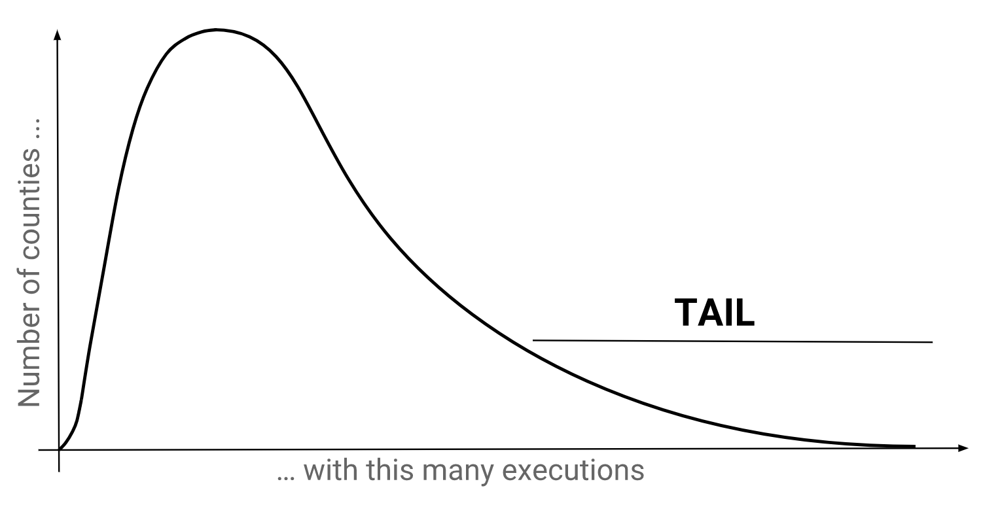

## Довгі хвости
«Довгий хвіст» розподілу — це невелика кількість спостережень із дуже великими значеннями. На графіку вони утворюють вузьку смугу далеко праворуч від основної маси даних, схожу на хвіст. Такі спостереження можуть указувати на нетипові випадки, які варто дослідити.
У нашому наборі даних довгий хвіст утворюють кілька округів Техасу, на які припадає особливо багато страт.

Обчислімо відсоток страт за вироками з кожного округу, щоб визначити, які округи потрапляють у цей хвіст.

Як ми поступово переконаємося, форма таблиць багато підказує про потрібні операції. Це нагадує аналіз розмірностей у фізиці. Тут уже зрозуміло, що попередніх прийомів недостатньо. У розділі [«Останні слова Бізлі»](beazley.html) ми працювали з окремими рядками, але для даних за округами потрібне агрегування. У розділі [«Заяви про невинуватість»](innocence.html) ми навчилися агрегувати дані, проте отримували один рядок для всього набору, а тепер потрібен один рядок для кожного округу.

 

## Частина GROUP BY
Саме тут знадобиться `GROUP BY`. Вона розбиває набір даних на групи й дає змогу застосувати агрегатні функції до кожної з них, отримавши по одному рядку на групу. Основний формат: <code class="codeblock">GROUP BY &lt;стовпець&gt;, &lt;стовпець&gt;, ...</code>. Ця частина стоїть після `WHERE`.

<sql-exercise
  data-question="Цей запит повертає кількість страт для кожного округу."
  data-default-text="SELECT
  county,
  COUNT(*) AS county_executions
FROM executions
GROUP BY county"></sql-exercise>

Якщо ви пам’ятаєте <a href='innocence.html#strange'>«Дивний запит»</a>, то, мабуть, насторожилися: хіба ми не вчилися уникати змішування агрегованих і неагрегованих стовпців? Тут відмінність у тому, що неагрегований стовпець використовується для групування. Усі рядки однієї групи мають у ньому однакове значення, тому немає неоднозначності щодо того, що повертати.

Ви, мабуть, також помітили `AS`. Це спосіб надати виразу псевдонім. У частині `SELECT` конструкція <code class="codeblock">&lt;вираз&gt; AS &lt;псевдонім&gt;</code> задає назву стовпця результату. У SQLite цей псевдонім можна використати, зокрема, у `GROUP BY` та `ORDER BY`. Так не потрібно повторювати довгі вирази, а їхнє призначення стає зрозумілішим.

<sql-exercise
  data-question="Цей запит рахує страти з останнім словом і без нього. Змініть запит, щоб додатково розподілити результати за округами."
  data-comment="Вираз <code>last_statement IS NOT NULL</code> працює як індикатор: 1 означає істину, а 0 — хибність."
  data-default-text="SELECT
  last_statement IS NOT NULL AS has_last_statement,
  COUNT(*)
FROM executions
GROUP BY has_last_statement"
  data-solution="SELECT
  last_statement IS NOT NULL AS has_last_statement,
  county,
  COUNT(*)
FROM executions
GROUP BY has_last_statement, county"
  ></sql-exercise>

 

## Частина HAVING
Наступна вправа показує, що фільтрування через `WHERE` відбувається до групування й агрегування. Це відповідає порядку запису: `WHERE` стоїть перед `GROUP BY`.

<sql-exercise
  data-question="Порахуйте для кожного округу кількість засуджених, яким на момент страти було щонайменше 50 років."
  data-comment="Це можна зробити за допомогою <code>CASE WHEN</code>, але цього разу спробуйте використати <code>WHERE</code>."
  data-default-text=""
  data-solution="SELECT county, COUNT(*)
FROM executions
WHERE ex_age >= 50
GROUP BY county"
  ></sql-exercise>

А що робити, якщо потрібно відфільтрувати вже отримані результати групування й агрегування? `WHERE` не може використати результат, якого на цьому етапі ще немає. Для цього існує `HAVING`.

<sql-exercise
  data-question="Виведіть округи, у яких було страчено понад 2 засуджених віком від 50 років."
  data-comment="Це продовження попередньої вправи. Потрібен додатковий фільтр, який використовує результат агрегування. Його не можна помістити в <code>WHERE</code>, адже ця частина працює раніше. Прочитайте про <a href='https://www.w3schools.com/sql/sql_having.asp'><code>HAVING</code></a>. Її можна уявляти як аналог <code>WHERE</code> для фільтрування після агрегування."
  data-default-text=""
  data-solution="
SELECT county
FROM executions
WHERE ex_age >= 50
GROUP BY county
HAVING COUNT(*) > 2"
  ></sql-exercise>

 
## Практика
Цей тест покликаний перевірити глибину вашого розуміння. Читайте пояснення, навіть якщо відповіли на всі запитання правильно.

<sql-quiz
  data-title="Позначте правильні твердження."
  data-description="Цей запит рахує засуджених за округами та десятирічними віковими інтервалами. <pre>
SELECT
  county,
  ex_age/10 AS decade_age,
  COUNT(*)
FROM executions
GROUP BY county, decade_age</pre>">
  <sql-quiz-option
    data-value="valid"
    data-statement="Запит коректний: його виконання не спричинить помилки."
    data-hint="Вас збентежив вираз <code>ex_age/10</code>? Групувати можна й за результатами обчислень над стовпцями."
    data-correct="true"></sql-quiz-option>
  <sql-quiz-option
    data-value="gran"
    data-statement="Якби замість <code>ex_age/10</code> ми використали <code>ex_age</code>, запит повернув би більше рядків."
    data-hint="Пам’ятайте: <code>ex_age/10</code> виконує цілочисельне ділення й відкидає дробову частину. Тому різні значення віку потрапляють в одну групу, а кількість унікальних груп зменшується."
    data-correct="true"></sql-quiz-option>
  <sql-quiz-option
    data-value="unique_combocc"
    data-statement="Кількість рядків результату дорівнюватиме кількості унікальних поєднань county і decade_age в наборі даних."
    data-hint="Так, це правильно."
    data-correct="true"></sql-quiz-option>
  <sql-quiz-option
    data-statement="Результат міститиме групу ('Bexar', 6), навіть якщо в окрузі Беар не було засуджених віком від 60 до 69 років на момент страти."
    data-hint="<code>GROUP BY</code> знаходить поєднання, які <i>справді є в наборі даних</i>, а не всі теоретично можливі."
    data-value="abstract_cartesian"></sql-quiz-option>
  <sql-quiz-option
    data-statement="Кожен рядок результату матиме інше значення county."
    data-hint="Це було б правильно, якби групування відбувалося лише за <code>county</code>. Тут один округ може мати багато груп із різними значеннями decade_age."
    data-value="one_col_diff"></sql-quiz-option>
  <sql-quiz-option
    data-statement="У результаті можуть бути групи, для яких кількість дорівнює 0."
    data-hint="Це той самий принцип, що й у прикладі з ('Bexar', 6). Якщо відповідних рядків немає, така група не з’явиться."
    data-value="count_zero"></sql-quiz-option>
  <sql-quiz-option
    data-statement="Запит залишиться коректним, навіть якщо прибрати <code>county</code> з частини <code>SELECT</code>."
    data-hint="Стовпці групування необов’язково виводити через <code>SELECT</code>. Запит працюватиме, але результат буде менш зрозумілим: ми не знатимемо, якому округу відповідає кожна кількість."
    data-value="missing_gp_col"
    data-correct="true"></sql-quiz-option>
  <sql-quiz-option
    data-statement="До частини <code>SELECT</code> доречно додати <code>last_name</code>, навіть якщо групування за ним немає."
    data-hint="SQLite дозволить це з причин, описаних у розділі <a href='innocence.html#strange'>«Дивний запит»</a>. Проте виводити стовпець, який ані не агрегується, ані не використовується для групування, тут недоречно: незрозуміло, чиє прізвище має представляти всю групу."
    data-value="extra_gp_col"></sql-quiz-option>
</sql-quiz>

<sql-exercise
  data-question="Виведіть усі унікальні округи з набору даних."
  data-comment="У попередньому розділі ми робили це через <code>SELECT DISTINCT</code>. Цього разу використайте звичайний <code>SELECT</code> разом із <code>GROUP BY</code>."
  data-default-text=""
  data-solution="SELECT county FROM executions GROUP BY county"
  ></sql-exercise>

 

## Вкладені запити
Можливо, ви запитаєте: хіба не можна завершити наше завдання ось таким запитом?

    SELECT
      county,
      PERCENT_COUNT(*)
    FROM executions
    GROUP BY county

Відсотки використовують так часто — невже немає такої функції? На жаль, `PERCENT_COUNT` тут не існує. Щоб отримати відсоток, потрібно агрегувати дані і в межах групи (чисельник), і в усьому наборі (знаменник). Один рівень запиту або має `GROUP BY`, або не має. Тому скористаємося двома запитами: один агрегуватиме з `GROUP BY`, інший — без неї. Поєднаємо їх за допомогою вкладення одного запиту в інший.

Ось приклад вкладеного запиту, або підзапиту. Дужки відокремлюють внутрішній запит від зовнішнього:

<sql-exercise
  data-question="Знайдіть ім’я та прізвище засудженого з найдовшим останнім словом за кількістю символів."
  data-comment="Замість &lt;<code>length-of-longest-last-statement</code>&gt; вставте підзапит, який повертає потрібну довжину."
  data-default-text="SELECT first_name, last_name
FROM executions
WHERE LENGTH(last_statement) =
    (<length-of-longest-last-statement>)"
  data-solution="SELECT first_name, last_name
FROM executions
WHERE LENGTH(last_statement) =
    (SELECT MAX(LENGTH(last_statement))
     FROM executions)"></sql-exercise>

Підзапит потрібен, бо під час перевірки умови `WHERE` для окремого рядка нам необхідна максимальна довжина з усього набору даних. Її слід обчислити окремо й використати отримане значення в умові. Тепер застосуймо цей підхід до обчислення відсотка страт для кожного округу.

<sql-exercise
  data-question="Замість &lt;<code>count-of-all-rows</code>&gt; вставте запит, який допоможе обчислити відсоток страт для кожного округу."
  data-comment="Число <code>100.0</code> забезпечує ділення з дробовим результатом, тому відсотки не обмежуватимуться цілими числами."
  data-default-text="SELECT
  county,
  100.0 * COUNT(*) / (<count-of-all-rows>)
    AS percentage
FROM executions
GROUP BY county
ORDER BY percentage DESC"
  data-solution="SELECT
  county,
  100.0 * COUNT(*) / (SELECT COUNT(*) FROM executions)
    AS percentage
FROM executions
GROUP BY county
ORDER BY percentage DESC"
  ></sql-exercise>

Я непомітно додав частину `ORDER BY`. Її формат: <code class="codeblock">ORDER BY &lt;стовпець&gt;, &lt;стовпець&gt;, ...</code>. За замовчуванням сортування відбувається за зростанням; щоб змінити його на спадання, додайте `DESC` після відповідного стовпця або виразу.

 

## Округ Гарріс
Чи дивно, що на округи Гарріс (де розташований Г’юстон), Даллас, Беар і Таррант припадає близько 50% усіх страт у цьому наборі даних Техасу? Можливо, якщо очікувати рівномірного розподілу між округами. Але логічніше спочатку припустити, що кількість страт пропорційна населенню. За [переписом Техасу 2010 року](https://www.tsl.texas.gov/ref/abouttx/popcnty12010.html), у цих чотирьох округах мешкало 10,0 млн людей — 40,0% населення штату (25,1 млн). Тож результат уже не здається настільки несподіваним.

Якщо дослідити хвіст докладніше, виявиться, що більша частина розбіжності припадає на округ Гарріс. На нього припадало лише 16,4% населення, але 23,1% страт. Це приблизно на 41% більше, ніж очікувалося б за пропорційного розподілу.

Причини такої кількості страт в окрузі Гарріс вивчали в численних дослідженнях. Серед можливих чинників називали такі:
 - 
Сторона обвинувачення була <a href="https://web.archive.org/web/20191227235319/https://www.citylab.com/equity/2014/09/one-texas-county-is-responsible-for-most-of-the-executions-in-the-entire-us/380705/">добре організована й профінансована</a>, тоді як призначені судом захисники мали недостатні стимули та ресурси. <a href="https://houstonlawreview.org/article/3874.pdf">(Джерело, с. 49)</a>

 - 
Багаторічний окружний прокурор був <a href="https://www.chron.com/news/houston-texas/article/Former-DA-ran-powerful-death-penalty-machine-1833545.php">рішучим прихильником смертної кари</a>.

 - 
Суддів у Техасі обирають, а населення підтримувало смертну кару. <a href="https://priceonomics.com/why-has-texas-executed-so-many-inmates/">(Джерело)</a>

 - 
У судовій системі округу Гарріс не працювали належним чином механізми стримувань і противаг. <a href="https://houstonlawreview.org/article/3874-the-problem-of-rubber-stamping-in-state-capital-habeas-proceedings-a-harris-county-case-study">(Джерело, с. 929)</a>

 

## Підсумок
У цьому розділі ми навчилися агрегувати дані в межах груп і використовувати результат внутрішнього запиту в зовнішньому. Зокрема, ці прийоми дали змогу обчислювати відсотки.

  <h3>MapReduce</h3>
  
Цікаве доповнення: фактично ми щойно познайомилися з ідеями MapReduce в SQL. MapReduce — відома модель програмування, у якій обчислення поділяють на застосування операції до елементів (map) і зведення результатів (reduce). Докладніше про неї можна прочитати <a href="https://stackoverflow.com/questions/28982/simple-explanation-of-mapreduce">тут</a>.

  
Розділ <a href="beazley.html">«Останні слова Бізлі»</a> відповідає ідеї map: ми застосовували операції до кожного рядка. Наприклад, <code>SELECT LENGTH(last_statement) FROM executions</code> обчислює довжину тексту для всіх рядків. У цьому розділі ми зводили групи даних за допомогою агрегатних функцій — це відповідає ідеї reduce. А розділ <a href="innocence.html">«Заяви про невинуватість»</a> розглядав окремий випадок, коли весь набір даних є однією групою.

У наступному розділі познайомимося зі з’єднаннями `JOIN`, які дають змогу працювати з кількома таблицями.
